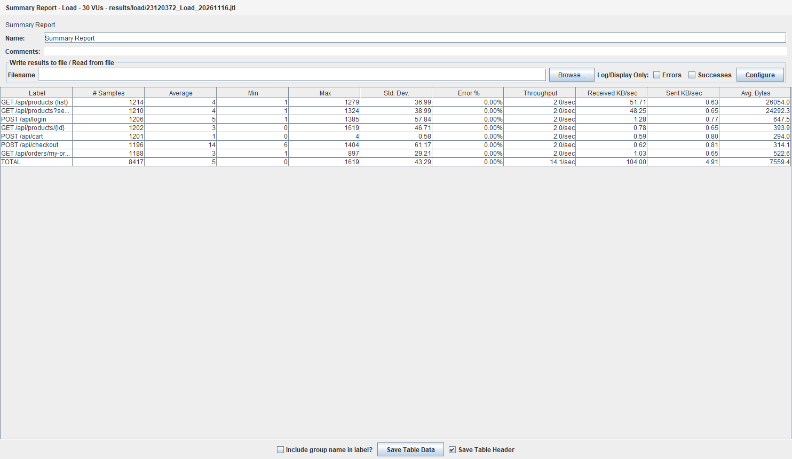
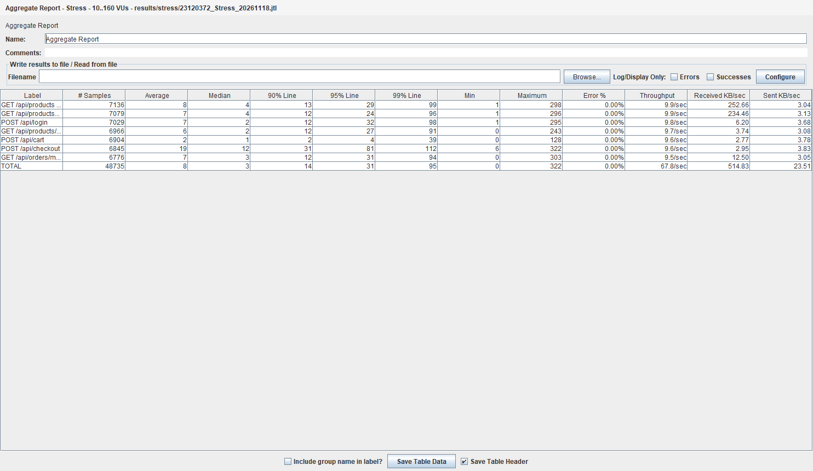
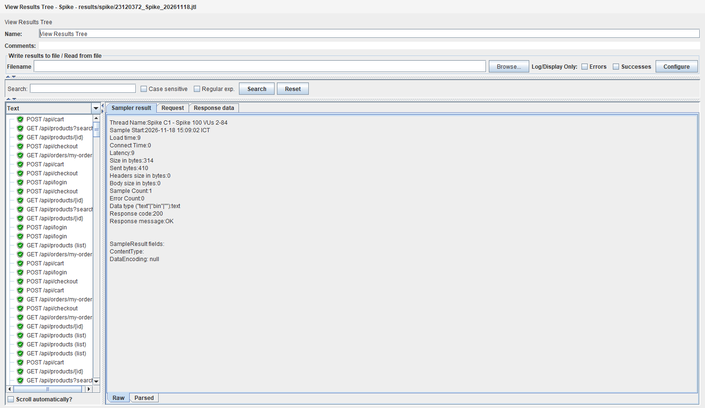
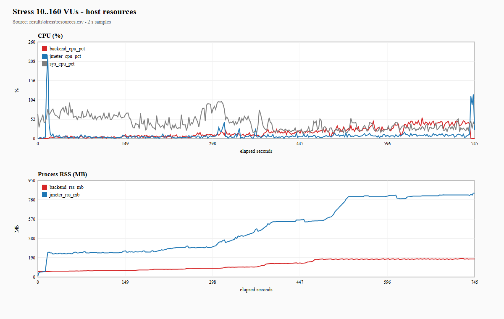
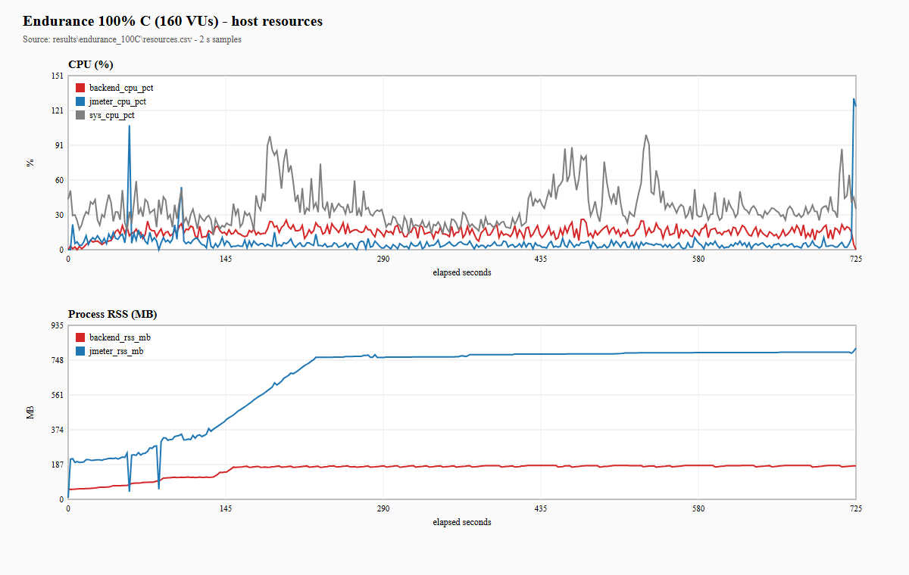

# HW05 - Báo cáo Performance Testing - EShop

**Sinh viên:** Phan Trung Tin - **MSSV:** 23120372  
**Môn:** Kiểm thử phần mềm - FIT, VNUHCM  
**SUT:** EShop - <https://github.com/ttbhanh/eshop-sut> (commit `85af3ba875c88283615e22cb108f13e2fccaf0e9`)  
**Repo bài làm:** <https://github.com/tinphan247/HW05_AI_Performance>  
**Ngày chạy chính thức:** 2026-11-16 (Load), 2026-11-18 (Stress/Spike/Endurance)

---

## 1. Tóm tắt

Bài làm dùng JMeter 5.6.3 để kiểm thử hiệu năng EShop trên một laptop Dell Latitude 7420
(i5-1145G7, 4 nhân / 8 luồng, 16 GB RAM, Windows 11 Pro). Ba kịch bản Load, Stress và Spike
dùng **cùng một workflow end-to-end** gồm đăng nhập, đọc danh sách/tìm kiếm/sản phẩm, thêm
vào giỏ, checkout và xem đơn hàng. Mỗi kịch bản dùng một report view khác nhau
(Summary Report / Aggregate Report / View Results Tree) và có một thư mục HTML dashboard
riêng. Ngoài ra bài làm chạy Endurance ở 50/75/100% năng lực Stress để xác định ngưỡng bền
vững, cùng một Lockout Probe tách riêng cho luồng đăng nhập sai.

Kết quả chính (số liệu lấy trực tiếp từ `.jtl` và `resources.csv`, không có số liệu tự đặt):

| Kịch bản | Tải | Thời lượng | Samples | Lỗi | p95 | p99 | Throughput |
|---|---|---:|---:|---:|---:|---:|---:|
| Load | 30 VUs, ramp 60 s | 600 s | 8.417 | 0 | 11 ms | 15 ms | 14,09 samples/s |
| Stress | 10 → 160 VUs, 6 mức | 6 × 120 s | 48.735 | 0 | 14-40 ms theo mức | 26-116 ms | 9,74 → 150,98 samples/s |
| Spike | 10 → 100 → 10 VUs, 3 chu kỳ | ~15 phút | 23.809 | 0 | 13-19 ms | 18-89 ms | 93,9-95,8 samples/s lúc spike |
| Endurance 50% C | 80 VUs | 720 s | 27.388 | 0 | 16 ms | 20 ms | 39,53 samples/s |
| Endurance 75% C | 120 VUs | 720 s | 40.762 | 0 | 21 ms | 123,69 ms | 58,89 samples/s |
| Endurance 100% C | 160 VUs | 720 s | 54.488 | 0 | 47 ms | 134,69 ms | 78,89 samples/s |

---

## 2. Môi trường và cấu hình

### 2.1. Hardware / phần mềm

| Thành phần | Giá trị |
|---|---|
| Hostname | `DESKTOP-BCS88BQ` |
| Máy | Dell Latitude 7420 |
| CPU | Intel Core i5-1145G7, 4 nhân / 8 luồng |
| RAM | 16 GB |
| OS | Windows 11 Pro 10.0.26200 |
| JMeter | Apache JMeter 5.6.3, JDK 17.0.12 |
| Backend | Node.js, SQLite, chạy tại `http://localhost:3100` |
| Load generator | JMeter chạy **cùng máy** với backend |

Bằng chứng hardware: `hardware/hardware_report.md`, `hardware/dxdiag.txt`,
`hardware/systeminfo.txt`.

### 2.2. SUT và thay đổi cục bộ

SUT được clone sạch từ repo chính thức, không sửa business logic. Thay đổi duy nhất là
port backend 3000 → 3100 vì máy đang dùng cổng 3000 cho một backend khác:

```js
const PORT = process.env.PORT || 3100;
```

Chi tiết: `docs/sut_port_patch.md`, commit SUT ghi tại `docs/sut_commit.txt`.

### 2.3. Dataset

- 500 user hiệu năng `perf001@eshop.test` … `perf500@eshop.test` / `Perf1234!`
- 200 product hiệu năng (ID 6…205), giữ 5 product gốc
- 1 user lockout riêng `lockout@eshop.test`
- Tổng: 503 user, 205 product, 0 order trước mỗi run
- CSV: `data/e2e_data.csv` (500 dòng), `data/lockout.csv`
- Script: `scripts/seed_perf_data.py`, `scripts/reset_state.py`, `scripts/generate_csv.py`

---

## 3. Thiết kế kiểm thử

### 3.1. Workflow dùng chung

Mỗi iteration của mọi plan chạy đúng 7 request:

1. `GET /api/products` - read-heavy
2. `GET /api/products?search=${search_keyword}` - read-heavy
3. `POST /api/login` - auth-heavy, extract token `$.token`
4. `GET /api/products/${product_id}` - read-heavy
5. `POST /api/cart` - transactional
6. `POST /api/checkout` - transactional
7. `GET /api/orders/my-orders` - transactional read

Assertion kiểm tra cả status code và body (`token`, `orderId`), không chỉ HTTP 200.
Think-time dùng `GaussianRandomTimer` (mean và range lấy từ `ConstantTimer.delay` +
`RandomTimer.range`): Load 2000 ± 1000 ms; Stress/Spike 1000 ± 500 ms. Đây là timer ngẫu
nhiên, không phải delay cố định.

### 3.2. Ba report view

| Plan | Report view | File JMX | HTML dashboard | Ảnh render |
|---|---|---|---|---|
| Load | **Summary Report** | `test-plans/23120372_Load_20261116.jmx` | `results/load/html/` | `screenshots/report_views/load_summary.png` |
| Stress | **Aggregate Report** | `test-plans/23120372_Stress_20261118.jmx` | `results/stress/html/` | `screenshots/report_views/stress_aggregate.png` |
| Spike | **View Results Tree** | `test-plans/23120372_Spike_20261118.jmx` | `results/spike/html/` | `screenshots/report_views/spike_view_results_tree.png` |

Listener được khai báo trong JMX nhưng tắt khi chạy non-GUI để tránh client bottleneck.
Sau khi chạy, `.jtl` được nạp lại vào **đúng class GUI của JMeter**
(`SummaryReport`, `StatVisualizer`, `ViewResultsFullVisualizer`) bằng
`tools/jtl_viewer/JtlScreenshot.java` rồi render ra PNG; phương pháp ghi trong
`docs/report_view_screenshots.md`. Đây không phải bảng HTML mô phỏng: số trong ảnh khớp
file `.jtl` đã nộp.

### 3.3. Lockout Probe

Đăng nhập sai 3 lần với `lockout@eshop.test`, pacing 1,5 s, nằm trong **plan riêng** để
các response 401/401/403 có chủ đích không làm tăng error rate của workflow chính.

---

## 4. Kết quả

### 4.1. Load test

- 30 VUs, ramp 60 s, duration 600 s, think 2000 ± 1000 ms
- 8.417 samples, **0 lỗi**, 14,088 samples/s
- p50 2 ms, p95 11 ms, p99 15 ms, average 5,17 ms
- Backend RSS 48,97 → 65,91 MB; CPU backend trung bình 3,12%, max 9,2%
- System CPU max 56,2%; JMeter RSS max 624,1 MB
- 1.196 order được tạo

Nguồn: `results/load/23120372_Load_20261116.jtl`, `analysis/load_summary.md`,
`results/load/manifest.md`, `results/load/resources.csv`.

**Nhận xét:** Ở mức tải này SUT rất nhanh, không có lỗi. p95 11 ms thấp hơn nhiều so với
SLO 1.000 ms. Đây là baseline cho các kịch bản sau.

Một điểm bất thường đáng ghi lại: max 1.619 ms **không** phải endpoint chậm. Toàn bộ
**15 sample > 100 ms** của run này kết thúc trong khoảng **161,053-161,292 s** kể từ sample
đầu tiên (rộng 0,239 s), tức cùng bị chặn bởi một stall toàn cục ~1,6 s ở cả 7 label, không
phải `GET /api/products/{id}` chậm riêng. Bằng chứng: `scripts/verify_task2_ai.py` in ra
danh sách end-time của 15 sample đó từ chính file `.jtl`.

### 4.2. Stress test

| Mức | VUs | Samples | Lỗi | RPS | p95 | p99 |
|---|---:|---:|---:|---:|---:|---:|
| S1 | 10 | 1.149 | 0 | 9,74 | 14 ms | 27 ms |
| S2 | 20 | 2.311 | 0 | 19,34 | 13 ms | 26 ms |
| S3 | 40 | 4.509 | 0 | 37,79 | 20 ms | 85 ms |
| S4 | 80 | 9.053 | 0 | 75,64 | 40 ms | 85 ms |
| S5 | 120 | 13.599 | 0 | 113,50 | 29 ms | 87 ms |
| S6 | 160 | 18.114 | 0 | 150,98 | 38 ms | 116 ms |

- Tổng 48.735 samples, **0 lỗi**, 67,82 samples/s tính cả 12 phút
- Max response time 322 ms
- Backend CPU max 56,2%; **system CPU max 99,5%**
- Backend RSS 53,23 → 181,37 MB; 6.845 order

Nguồn: `results/stress/23120372_Stress_20261118.jtl`, `analysis/stress_summary.md`.

**Nhận xét:** Trong 6 mức đã chạy, chưa thấy knee của SUT: throughput tăng gần tuyến tính
theo VUs và p95 vẫn dưới 40 ms. Tuy nhiên system CPU đạt 99,5% ở mức 160 VUs, tức là
**host đã bão hòa** (JMeter + backend + monitor cùng máy). Vì vậy không thể kết luận SUT
chịu được hơn 160 VUs; chỉ có thể nói cấu hình đo này đạt 150,98 samples/s mà chưa có lỗi.
Đây là validity threat đã ghi trong mục 9.

### 4.3. Spike test

| Chu kỳ | Pha | Samples | RPS | p95 | p99 |
|---|---|---|---:|---:|---:|
| C1 | Baseline 10 VUs | 1.141 | 9,64 | 13 ms | 19,6 ms |
| C1 | Spike 100 VUs | 5.606 | 93,88 | 18 ms | 89 ms |
| C1 | Recovery 10 VUs | 1.175 | 9,92 | 15 ms | 28,26 ms |
| C2 | Spike 100 VUs | 5.646 | 94,43 | 17,75 ms | 59 ms |
| C3 | Spike 100 VUs | 5.678 | 95,82 | 19 ms | 68,46 ms |

- 23.809 samples, **0 lỗi**
- Backend RSS 54,77 → 122,36 MB; CPU backend max 45,2%; system CPU max 80,1%

Nguồn: `results/spike/23120372_Spike_20261118.jtl`, `analysis/spike_summary.md`.

**Nhận xét:** SUT hấp thụ được cú tăng 10× (10 → 100 VUs trong 5 s) mà không có lỗi;
p95 chỉ tăng từ 13-16 ms lên 17-19 ms. Sau mỗi spike, throughput trở lại ~9,6 samples/s
ngay trong bucket 30 s kế tiếp, không thấy recovery chậm.

### 4.4. Endurance và ngưỡng bền vững

**Định nghĩa trước khi đo** (PLAN.md mục 5.1): mức cao nhất giữ được 10-15 phút với
error < 1%, p95 < 1.000 ms, p99 < 2.000 ms, CV throughput (bucket 30 s) < 10%,
RSS backend tăng < 10% sau warm-up 300 s, CPU backend trung bình < 85%.

Stress cho C = 160 VUs (mức cao nhất đã chạy và đạt SLO). Ba mức endurance: 80 / 120 / 160 VUs,
mỗi mức 720 s, ramp 60 s, cùng dataset và workflow.

| Mức | VUs | RPS steady | CV 30 s | p95 | p99 | Lỗi | RSS max | RSS tăng sau 300 s | CPU backend | Kết luận |
|---|---:|---:|---:|---:|---:|---:|---:|---:|---:|---|
| 50% C | 80 | 39,53 | 1,99% | 16 ms | 20 ms | 0% | 179,84 MB | 1,3% | 14,25% | PASS |
| 75% C | 120 | 58,89 | 2,18% | 21 ms | 123,69 ms | 0% | 182,34 MB | 1,3% | 12,44% | PASS |
| 100% C | 160 | 78,89 | 1,28% | 47 ms | 134,69 ms | 0% | 182,25 MB | -0,1% | 15,86% | PASS |

Nguồn: `analysis/endurance_50C/endurance_50C.md`,
`analysis/endurance_75C/endurance_75C.md`,
`analysis/endurance_100C/endurance_100C.md`,
`analysis/endurance_threshold.md`.

**Ngưỡng:** **160 VUs - 78,89 samples/s** (steady-state, bucket 30 s) giữ ổn định 720 s với
0 lỗi, CV 1,28%, p95 47 ms, p99 134,69 ms. Đây là mức cao nhất đã kiểm thử và vẫn PASS mọi
tiêu chí đăng ký trước; vì không chạy mức cao hơn nên ngưỡng thật của SUT có thể cao hơn.
Tuy nhiên system CPU đã chạm 99,7% ở mức này, nên con số trên là giới hạn của **cấu hình đo**
(JMeter + backend + monitor cùng một laptop 4C/8T), không phải capacity của EShop trên
hardware riêng.

**Memory ceiling:** **182,25 MB** backend RSS (đo tại 681,02 s ở mức 160 VUs); đỉnh cao nhất
trong cả ba mức là 182,34 MB ở 75% C. Sau 300 s, RSS thay đổi **-0,1%** ở 100% C và **+1,3%**
ở 50% C / 75% C, tức đã plateau chứ không tăng tuyến tính.

**Nhận xét về bộ nhớ:** RSS tăng nhanh trong ~5 phút đầu (57,95 → ~180 MB) rồi gần như
đi ngang: từ 300 s đến hết run chỉ tăng 1,3% ở mức 120 VUs. Vì vậy **không** kết luận
"memory leak tuyến tính 8 MB/phút" chỉ từ slope của cả cửa sổ; slope sau 300 s mới là
chỉ báo đúng. Việc cart không được xóa sau checkout vẫn là lỗi logic (xem Issue 04),
nhưng trong 12 phút nó chưa tạo ra tăng trưởng vô hạn đo được.

---

## 5. Bug và performance issue

Các issue được tái hiện bằng `scripts/repro_issues.py`; output thô lưu tại
`evidence/issues/repro_20261118_160048.json`. Issue trên GitHub:
[#1](https://github.com/tinphan247/HW05_AI_Performance/issues/1),
[#2](https://github.com/tinphan247/HW05_AI_Performance/issues/2),
[#3](https://github.com/tinphan247/HW05_AI_Performance/issues/3),
[#4](https://github.com/tinphan247/HW05_AI_Performance/issues/4),
[#5](https://github.com/tinphan247/HW05_AI_Performance/issues/5),
[#6](https://github.com/tinphan247/HW05_AI_Performance/issues/6),
[#7](https://github.com/tinphan247/HW05_AI_Performance/issues/7),
[#8](https://github.com/tinphan247/HW05_AI_Performance/issues/8).

| # | Vấn đề | Mức | Bằng chứng |
|---|---|---|---|
| 01 | Lockout +2 lượt / 180 s (spec +1 / 30 s) | High | 3 lần sai trả 401, 401, 403; DB `login_attempts=4`, `locked_until` +180 s (còn 177 s) |
| 02 | Race async: 3 lần sai liên tiếp đều 401 | Medium | 3 request đồng thời; DB đã khóa nhưng client không nhận 403 |
| 03 | Checkout tin `total_amount` từ client | High | Order lưu `total_amount=1` dù giá sản phẩm 30.000.000 |
| 04 | Cart không xóa sau checkout, lưu in-memory | Medium | 25 lần add → 25 item; cart sau checkout vẫn còn |
| 05 | `/api/products` không phân trang | Medium | 205 item, response không đổi khi thêm `limit=5` |
| 06 | `price` là string với ID chẵn, number với ID lẻ | Low | ID 3 → number, ID 4 → string |
| 07 | Search nối chuỗi SQL, trả 500 với dấu nháy | Critical | `?search='` → HTTP 500 |
| 08 | Product create/update/delete không cần auth | Critical | POST/PUT/DELETE không token đều thành công |

Chi tiết từng issue: `docs/issues/`.

---

## 6. AI Audit và AI Critique

- Toàn bộ prompt, output, thời điểm và phần review của người làm nằm trong
  `ai_audit/` (index: `ai_audit/README.md`).
- Task 2 (AI đọc `.jtl`, con người sửa) nằm trong `Task2_AI_Analysis.md`; output gốc của AI
  ở `ai_audit/entries/005_task2_ai.md`. AI đọc đúng toàn bộ p50/p95/p99/max và các cột
  `resources.csv`, nhưng bịa nội dung JMX, nói sai số VU ở đỉnh Stress, suy "CPU throttle"
  từ một trường WMI, và biến ngoại suy thành threshold (250 MB, 100 req/s). Bảng phân loại
  feasible / cần thêm dữ liệu / không khả thi / hallucinated nằm trong mục 3 của file đó.
- AI Critique 200-300 từ: `AI_Critique.md`.
- AI Audit Report đầy đủ: `AI_Audit_Report.md` / `.pdf`.

---

## 7. Task 3 - Continuous performance testing

Đề xuất và flow chart nằm trong `docs/task3_continuous_testing.md`; prototype CI ở
`ci/perf-gate.yml` và `ci/compare_baseline.py`. Tóm tắt: chạy smoke perf trên mỗi PR,
so p95/p99/error rate với baseline đã lưu, chỉ chạy full Load/Stress/Spike trên nhánh
chính hoặc theo lịch; trade-off về chi phí runner và false alarm được phân tích trong
tài liệu.

---

## 8. Agent Skill

Skill `jmeter-perf-testing` nằm trong `skills/jmeter-perf-testing/`, gồm `SKILL.md`,
references, templates và scripts. Video demo: **chưa có link** - cần quay theo
`VIDEO_SCRIPT.md` mục 6:00-6:30 và upload unlisted, sau đó dán link vào đây và README.

---

## 9. Hạn chế và validity threats

1. **Client và server cùng máy.** JMeter, backend và monitor chia sẻ 4 nhân / 8 luồng.
   System CPU đạt 99,5% ở Stress S6; throughput đo được bị giới hạn bởi host, không phải
   chỉ bởi SUT.
2. **SQLite và dữ liệu nhỏ.** 205 product, 503 user; chưa kiểm tra với dữ liệu lớn.
3. **Cart in-memory.** Backend restart sẽ xóa cart; mỗi lần restart cũng drop/reseed DB,
   nên trạng thái được kiểm soát bằng seed + reset trước mỗi run.
4. **Cùng một workflow cho cả ba plan.** Đúng yêu cầu nhưng không bao phủ toàn bộ API.
5. **Report view screenshot** được render lại từ `.jtl` bằng đúng component JMeter, không
   phải ảnh chụp màn hình lúc chạy; dữ liệu trong ảnh khớp file `.jtl` đã nộp.
6. **Không có máy load generator thứ hai**, nên chưa tách được bottleneck client/server.

---

## 10. Tái lập

```powershell
# 1. Backend
cd sut\eshop-sut\backend
node server.js                       # listens on 3100, drops/reseeds DB

# 2. Dataset (after the server is listening)
cd C:\HCMUS\hk7\Testing\hw5
python scripts\seed_perf_data.py
python scripts\reset_state.py

# 3. Run a scenario
python scripts\run_scenario.py --scenario load --date 20261116
python scripts\run_scenario.py --scenario stress --date 20261118
python scripts\run_scenario.py --scenario spike --date 20261118
python scripts\run_scenario.py --scenario endurance --threads 120 --duration 720 --out-dir results/endurance_75C

# 4. Analysis
python scripts\analyze_jtl.py --scenario load --jtl results\load\23120372_Load_20261116.jtl
python scripts\endurance_stats.py --run-dir results/endurance_75C --label 75C --out-dir analysis/endurance_75C
python scripts\endurance_threshold.py --runs analysis/endurance_50C analysis/endurance_75C analysis/endurance_100C
```

---

## Phụ lục - Bản đồ artifact

| Artifact | Đường dẫn |
|---|---|
| JMX plans | `test-plans/` |
| Raw JTL + HTML + resource CSV + manifest | `results/<scenario>/` |
| Phân tích JTL | `analysis/<scenario>_summary.md`, `analysis/endurance_*/` |
| Ảnh report view | `screenshots/report_views/` |
| Ảnh tool + resource monitor | `screenshots/` |
| Hardware | `hardware/` |
| AI audit | `ai_audit/` |
| Issue drafts | `docs/issues/` |
| Repro evidence | `evidence/issues/` |

---

## Phụ lục ảnh bằng chứng

Ba report view dưới đây là ảnh render từ chính `.jtl` đã nộp bằng đúng class GUI của JMeter
(xem `docs/report_view_screenshots.md`), không phải bảng HTML mô phỏng.

### A1. Summary Report - Load



### A2. Aggregate Report - Stress



### A3. View Results Tree - Spike



### A4. Resource monitor - CPU/RSS của backend, JMeter và system

Các biểu đồ dưới đây được vẽ trực tiếp từ `results/<run>/resources.csv` (2 s/sample) bằng
`scripts/plot_resources.py`, không phải ảnh chụp màn hình Task Manager.







