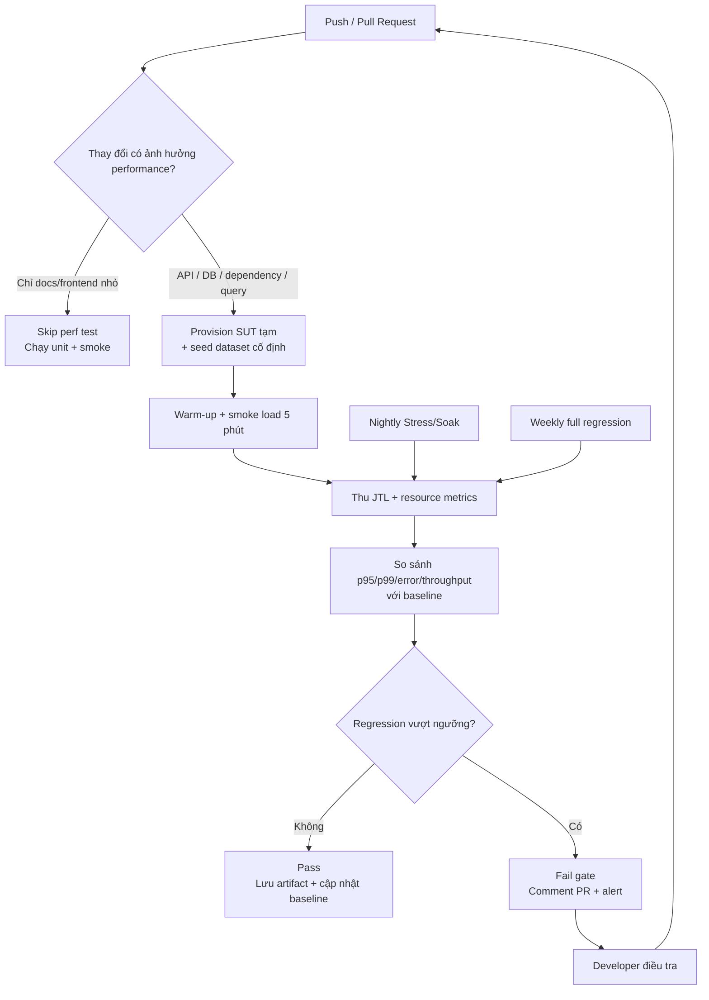

# HW05 — Kế hoạch thực hiện Performance Testing trên EShop

**Sinh viên:** Phan Trung Tin — **MSSV:** 23120372  
**Môn:** Software Testing — FIT, VNUHCM  
**SUT:** EShop — https://github.com/ttbhanh/eshop-sut  
**Ngày lập kế hoạch:** 16/11/2026  
**Trạng thái:** KẾ HOẠCH — **chưa thực thi**. Mọi con số trong tài liệu này là *giá trị khởi điểm* hoặc *template*, không phải kết quả đo. Kết quả thật chỉ được điền từ `.jtl`, log và ảnh chụp sau khi chạy.

> **Nguyên tắc:** Không bịa số liệu, không bịa bug, không tự nhận là đã chạy. File này chỉ mô tả cách làm và bằng chứng sẽ tạo ra. Các chỗ cần bạn xác nhận được đánh dấu **[CẦN XÁC NHẬN]** ở §14.

---

## 0. Tóm tắt điều hành

Bài HW05 yêu cầu một quy trình performance testing hoàn chỉnh trên backend EShop, gồm:

1. **Task 1:** Dùng AI theo từng bước để thiết kế 3 test plan **Load / Stress / Spike**, tất cả cùng một workflow end-to-end phủ 3 nhóm endpoint **auth-heavy + read-heavy + transactional**; dữ liệu hóa bằng CSV; dùng 3 loại report view khác nhau; chạy thật, chụp tool + resource monitor + hardware; tìm **endurance threshold**; quay video thuyết minh tiếng Việt; log bug/performance issue lên GitHub Issues.
2. **Task 2:** Dùng AI phân tích `.jtl`, đề xuất threshold; sau đó **con người kiểm tra lại**, chỉ ra AI đọc sai metric nào, trích giá trị đúng từ raw log; phân loại các đề xuất tối ưu của AI thành **feasible / hallucinated**.
3. **Task 3:** Đề xuất mô hình **continuous performance testing** có flow chart, cơ chế quyết định có chạy test hay không và phát hiện regression p95, kèm trade-off.
4. **Agent Skill:** đóng gói quy trình thành skill tái sử dụng + video demo end-to-end trên một nhóm endpoint.
5. **Hồ sơ bắt buộc:** Main report (MD + PDF), AI Audit Report, AI Critique 200–300 từ, Git commit log, README tự đánh giá, link repo public, link YouTube unlisted, bug issues, zip đúng tên.

Kế hoạch này được thiết kế để **mỗi yêu cầu trong đề đều có artifact và bằng chứng tương ứng** (xem ma trận truy vết §13).

---

## 1. Phân tích đề bài

### 1.1. Mục tiêu và sản phẩm bắt buộc

| Nhóm | Sản phẩm | Nơi lưu |
|---|---|---|
| Task 1 | 3 file `.jmx` Load / Stress / Spike, cùng workflow, có CSV | `test-plans/` |
| Task 1 | CSV input data | `data/` |
| Task 1 | 3 raw `.jtl` đầy đủ + 3 thư mục HTML report | `results/`, `reports/` |
| Task 1 | Ảnh tool + resource monitor; ảnh hardware + bảng spec | `screenshots/`, `hardware/` |
| Task 1 | Số liệu endurance threshold (RPS, memory ceiling) | Main report |
| Task 1 | Video YouTube unlisted ≥ 6 phút, narration tiếng Việt | Link trong README/report |
| Task 1 | GitHub Issues cho bug/perf issue | Repo HW05 |
| Task 2 | AI analysis + bảng misinterpretation có giá trị đúng từ raw log | Main report |
| Task 2 | Bảng feasibility của optimization AI đề xuất | Main report |
| Task 3 | Flow chart + trade-off continuous performance testing | Main report |
| Agent Skill | `SKILL.md` + scripts/templates + video demo | `skills/` + YouTube |
| Bắt buộc | Main report MD + PDF | `Main_Report.md`, `.pdf` |
| Bắt buộc | AI Audit Report MD + PDF | `AI_Audit_Report.md`, `.pdf` |
| Bắt buộc | AI Critique 200–300 từ | Trong report + file riêng |
| Bắt buộc | Git commit log text | `git_commit_log.txt` |
| Bắt buộc | README + bảng tự đánh giá + test summary | `README.md` |
| Bắt buộc | Zip đúng format | `23120372_HW05_AI_Performance_XXX.zip` |

### 1.2. Các “bẫy” của đề cần xử lý rõ

| # | Yêu cầu / bẫy | Cách xử lý trong kế hoạch |
|---|---|---|
| 1 | 3 test plan phải cùng **một** workflow end-to-end, không phải 3 workflow rời | Dùng chung một “E2E workflow” gồm login → browse/search → detail → cart → checkout → my-orders; chỉ khác tham số tải |
| 2 | Workflow phải phủ **cả 3** nhóm endpoint | Mỗi vòng lặp có ít nhất 1 request auth, ≥ 2 request read, ≥ 2 request transactional |
| 3 | Phải **data-driven bằng CSV** | 1 file `e2e_data.csv` chứa credentials, product, order payload; 1 file `lockout.csv` cho probe |
| 4 | 3 **report view khác nhau**, không lặp | Load = Summary Report; Stress = Aggregate Report; Spike = View Results Tree; HTML dashboard là artifact bắt buộc riêng, không tính vào 3 view này |
| 5 | Tên file `{StudentID}_{ScenarioType}_{YYYYMMDD}` | `23120372_Load_20261116.jmx`, `..._Stress_...`, `..._Spike_...`; đổi ngày theo ngày chạy thật |
| 6 | Stress/Spike có thể trigger lockout 3 lần sai | Tạo **Lockout Probe** riêng, dùng tài khoản riêng, reset sau mỗi run; ghi log reset |
| 7 | AI-first nhưng phải **review và sửa** | Prompt theo từng bước; bảng “AI nói gì / sai gì / sửa gì / bằng chứng” |
| 8 | Phải có endurance threshold **có số cụ thể** | Định nghĩa threshold trước, chạy 10–15 phút ở nhiều mức, báo max stable RPS + memory ceiling |
| 9 | Video phải có **tool + resource monitor cùng frame**, giọng tiếng Việt | Quay màn hình full desktop, mở JMeter + Task Manager cạnh nhau; narration trực tiếp |
| 10 | Anti-cheat: filename, raw JTL, video, hostname | Không đổi tên; giữ full JTL; quay video thật; dùng đúng máy đã dùng cho HW trước |
| 11 | Git commit từng bước | Commit theo bảng §10; xuất log text |
| 12 | Agent Skill tuy ghi “encouraged” nhưng có **10 điểm** | Làm skill + video demo, không bỏ |
| 13 | AI Audit bắt buộc | Log mọi prompt/output/date-time; không tóm tắt thay output |
| 14 | AI Critique 200–300 từ | Viết sau khi có kết quả; đếm từ; nêu ví dụ cụ thể |

### 1.3. Fact-check SUT — những gì đã kiểm chứng từ source

Các điểm dưới đây được kiểm tra từ bản clone `HW2/eshop-sut` và file `backend/server.js` tại commit đang có. **Khi làm HW05 phải dùng bản clone sạch từ repo chính thức**, không dùng bản local đã bị sửa.

| Hạng mục | Giá trị / hành vi | Nguồn / ghi chú |
|---|---|---|
| Repo chính thức | `https://github.com/ttbhanh/eshop-sut` | README SUT |
| Commit local hiện tại | `85af3ba875c88283615e22cb108f13e2fccaf0e9` | `git rev-parse HEAD`; phải `git fetch` và ghi lại commit thật khi chạy |
| Port backend chính thức | **3000** (`const PORT = 3000;`) | `git show HEAD:backend/server.js` |
| Port dùng cho HW05 | **3100** (`const PORT = process.env.PORT \|\| 3100;`) | Máy đã có backend Aptis chạy port 3000; patch chỉ đổi port, không đổi logic — xem `docs/sut_port_patch.md` |
| Port bản local HW2 | 3001 (`process.env.PORT || 3001`) | Bản local đã bị sửa; **không dùng** cho HW05 |
| Seed users | `admin@eshop.com` / `Admin123!` (admin), `test@eshop.com` / `Test1234!` (user) | `backend/database.js` |
| Seed products | 5 sản phẩm | `backend/database.js` |
| Seed categories | 3 danh mục | `backend/database.js` |
| Seed coupons | 4 mã: SAVE10, BIGBUY, VIP100, EXPIRED | `backend/database.js` |
| Login sai | Code cộng **+2** mỗi lần sai; `newAttempts >= 3` thì khóa **180000 ms = 180 giây** | `backend/server.js`; **khác spec** (+1, 30 giây) |
| Checkout | Nhận `total_amount` từ client, không tự tính lại; không xóa cart | `POST /api/checkout` |
| Cart | Lưu **in-memory** trong object `userCarts`, không persist, không clear sau checkout | `server.js` |
| Product list | `SELECT * FROM products`, **không phân trang** | `GET /api/products` |
| Product search | Nối chuỗi trực tiếp `LIKE '%${searchQuery}%'` | Không dùng ký tự đặc biệt/quote trong CSV test |
| Product detail | Với id chẵn, `price` bị đổi thành string | Assertion không được yêu cầu price là number |
| Tài liệu setup | Ghi admin password `admin123`, nhưng seed là `Admin123!` | Dùng password seed thật; ghi lại mismatch nếu cần |
| Dữ liệu mặc định | 2 users, 5 products, 3 categories, 4 coupons, 0 orders | Sau `node database.js` |
| **Startup behavior** | Mỗi lần `node server.js`, `database.js` được load và **DROP + seed lại toàn bộ DB** | `database.js` gọi `initDatabase()`; đã kiểm chứng: seed trước khi start bị xóa |

**Kết luận Fact-check:** phải dùng **clean clone** của repo chính thức, chạy **port 3100** (official default là 3000; local patch đổi port để không đụng backend Aptis), seed lại DB, và ghi rõ commit/hash. Bản local 3001 chỉ là bản thí nghiệm của HW2, không dùng làm SUT cho HW05.

### 1.4. Các điểm chưa xác định — không tự bịa

Các điểm này ảnh hưởng trực tiếp đến tính hợp lệ của bài; xem câu hỏi ở §14:

- Thành viên nhóm và workflow nào đã được phân công (đề yêu cầu **không trùng workflow** giữa các thành viên).
- Tên repo GitHub HW05 và tài khoản public.
- Hostname của máy đã dùng trong các HW trước có đúng là `DESKTOP-BCS88BQ` không.
- Có được dùng thêm máy thứ hai làm load generator không (nếu có, kết quả sạch hơn).
- Có cần bonus k6 hay chỉ JMeter.
- Công cụ AI nào sẽ khai báo trong AI Audit (OpenCode/DeepSeek, ChatGPT, Claude…).
- Có khả năng quay video có giọng nói và upload YouTube unlisted không.
- Deadline thực tế và ngôn ngữ báo cáo (Việt/Anh).

---

## 2. Phạm vi và thiết kế workflow

### 2.1. Chọn 3 nhóm endpoint

| Nhóm | Endpoint | Method | Auth | Vai trò trong workflow | Ghi chú |
|---|---|---|---|---|---|
| **Auth-heavy** | `/api/login` | POST | Không | Lấy JWT cho user | Có thêm probe lockout riêng |
| Auth-heavy (probe) | `/api/login` (sai mật khẩu) | POST | Không | Kiểm tra hành vi khóa tài khoản | 1 thread, 3 request, tài khoản riêng |
| **Read-heavy** | `/api/products` | GET | Không | Danh sách sản phẩm | Không phân trang; payload lớn nếu seed nhiều |
| Read-heavy | `/api/products?search=...` | GET | Không | Tìm kiếm | Dùng keyword ASCII an toàn |
| Read-heavy | `/api/products/{id}` | GET | Không | Chi tiết sản phẩm | price có thể là string với id chẵn |
| **Transactional** | `/api/cart` | POST | Bearer | Thêm sản phẩm | Cart in-memory |
| Transactional | `/api/checkout` | POST | Bearer | Tạo đơn | Backend nhận total từ client |
| Transactional (read) | `/api/orders/my-orders` | GET | Bearer | Xác nhận đơn vừa tạo | Danh sách đơn tăng dần |

### 2.2. Workflow end-to-end dùng chung cho cả 3 plan

Mỗi virtual user thực hiện một vòng lặp:

1. `GET /api/products` — read-heavy.
2. `GET /api/products?search=${search_keyword}` — read-heavy.
3. `POST /api/login` với `${email}`, `${password}` — auth-heavy; extract `${token}`.
4. `GET /api/products/${product_id}` — read-heavy.
5. `POST /api/cart` với Bearer `${token}` và body `${product_id}`, `${product_name}`, `${price}`, `${quantity}` — transactional.
6. `POST /api/checkout` với Bearer `${token}`, body `${total_amount}`, `${shipping_address}` — transactional.
7. `GET /api/orders/my-orders` với Bearer `${token}` — transactional read.
8. Think-time (Gaussian Random Timer) trước khi lặp lại.

**Tỷ lệ request mỗi vòng:** 4 read + 1 auth + 3 transactional = 8 request. Như vậy workflow thực sự “read-heavy” nhưng vẫn phủ đủ 3 nhóm. Không thêm bước nào làm thay đổi bản chất end-to-end.

**Vì sao chọn workflow này:**

- Đúng mẫu đề gợi ý: login → browse/search → add to cart → checkout.
- Có correlation thật: token từ login được dùng cho cart/checkout/orders.
- Có ghi dữ liệu thật: checkout tạo order trong SQLite, nên đo được write contention, DB growth.
- Có đọc dữ liệu tăng dần: `my-orders` và cart in-memory giúp phát hiện memory growth.
- Cùng một workflow cho cả 3 plan, đúng yêu cầu “same end-to-end workflow”.

### 2.3. Data-driven bằng CSV

**File chính: `data/e2e_data.csv`** — một dòng cho một “lượt” end-to-end, đủ cột để parameterize mọi request:

```csv
email,password,product_id,product_name,price,quantity,search_keyword,shipping_address,total_amount
perf001@eshop.test,Perf1234!,1,iPhone 15 Pro Max,30000000,2,iPhone,123 Nguyen Trai Q1 HCM,60000000
perf002@eshop.test,Perf1234!,2,Samsung Galaxy S24 Ultra,28000000,1,Galaxy,456 Le Loi Q1 HCM,28000000
...
```

- **Tối thiểu 500 dòng**, email unique, password hợp lệ, product_id trải đều 1..N.
- `total_amount = price * quantity` để payload hợp lý (dù backend không validate, dữ liệu phải nhất quán).
- `search_keyword` chỉ dùng chữ ASCII (`iPhone`, `Galaxy`, `MacBook`, `AirPods`, `Keychron`) để tránh lỗi encoding/URL.
- Địa chỉ không chứa dấu phẩy, hoặc bọc quote; bật “Allow quoted data”.
- File **`data/lockout.csv`**: 1 dòng `email,wrong_password` cho tài khoản `lockout@eshop.test`.

**JMeter CSV Data Set Config:**

| Thuộc tính | Giá trị | Lý do |
|---|---|---|
| Filename | `data/e2e_data.csv` (relative) | Repo portable |
| File encoding | `UTF-8` | Tên sản phẩm/địa chỉ tiếng Việt |
| Variable names | `email,password,product_id,product_name,price,quantity,search_keyword,shipping_address,total_amount` | Khớp header |
| Delimiter | `,` | CSV chuẩn |
| Allow quoted data | `True` | Địa chỉ/tên có thể có dấu phẩy |
| Recycle on EOF | `True` | Chạy dài không dừng |
| Stop thread on EOF | `False` | Không dừng giữa test |
| Sharing mode | `All threads` | Các thread lấy dòng khác nhau, tránh tất cả dùng 1 account |

> **Lưu ý:** `Sharing mode = Current thread` sẽ khiến mọi thread bắt đầu từ dòng 1 → tất cả dùng cùng account. Đây là lỗi cấu hình phổ biến của AI; kế hoạch dùng `All threads` và kiểm tra thực tế bằng log “login user” hoặc thêm debug sampler trong lần pilot.

### 2.4. Dữ liệu seed đề xuất

Để read-heavy có ý nghĩa và stress đủ tải, seed thêm dữ liệu **bên ngoài code SUT**:

| Đối tượng | Số lượng | Cách seed | Ghi chú |
|---|---|---|---|
| Users | 500 | Script Node/SQLite `scripts/seed_perf_data.js` | Email `perf001..perf500@eshop.test`, password `Perf1234!`; role user |
| Lockout user | 1 | Cùng script | `lockout@eshop.test` / `Lockout123!` |
| Products | 200 | Cùng script | ID 1..205 (5 seed + 200), giá/quantity hợp lệ |
| Orders | 0 | Reset trước mỗi run | Không seed order để đo write |
| Coupons | Giữ 4 seed | Không đổi | Không dùng coupon trong workflow chính |

- Seed bằng script ngoài SUT, **không sửa** `server.js`, `database.js` hay schema.
- Trước khi seed: stop backend để tránh SQLite lock.
- Ghi lại số lượng thực tế sau seed vào `run_manifest`.
- Nếu muốn giữ dataset gốc 5 sản phẩm để so sánh, chạy thêm một baseline nhỏ; nhưng dataset chính thức của cả 3 plan phải **giống nhau**.

### 2.5. Không trùng workflow trong nhóm

Đề yêu cầu “no two members may test the same workflow”. Kế hoạch này chọn workflow **Auth + Product browse/search + Cart + Checkout**. Trước khi chạy, phải xác nhận với nhóm:

- Nếu thành viên khác cũng chọn đúng chuỗi này → phải đổi (ví dụ: người khác làm admin product CRUD, người khác làm coupon/order history) hoặc tách endpoint group.
- Ghi biên bản xác nhận vào `docs/group_scope.md` (tên thành viên, workflow, ngày xác nhận).
- Không tự khẳng định “không trùng” khi chưa có xác nhận.

---

## 3. Ba test plan

### 3.1. Cấu hình chung

| Thành phần | Giá trị |
|---|---|
| JMeter | Apache JMeter 5.6.3, JDK 17 |
| Base URL | `http://localhost:3100` |
| HTTP Request Defaults | protocol `http`, server `localhost`, port `3100` (property `${__P(port,3100)}`), encoding `UTF-8` |
| Header Manager | `Content-Type: application/json`; các request cần auth thêm `Authorization: Bearer ${token}` |
| JSON Extractor | Login: `$.token`, default `TOKEN_NOT_FOUND`, fail nếu không có |
| Assertions | Response Code đúng; JSON body chứa `token` / `orderId`; không có `error` bất ngờ |
| Think-time | Gaussian Random Timer: Load 2000 ± 1000 ms; Stress/Spike 1000 ± 500 ms |
| Transaction Controller | “E2E_Flow”, bật “Generate parent sample” để đo transaction |
| Kết quả | `.jtl` CSV đầy đủ; HTML dashboard; screenshot report view |

**Không dùng** `View Results Tree` ở chế độ live trong Stress/Spike vì listener này giữ toàn bộ response trong RAM, làm sai lệch client. Chỉ mở `.jtl` đã lưu bằng GUI sau khi chạy để chụp report view.

### 3.2. Load test

| Tham số | Giá trị khởi điểm | Lý do |
|---|---|---|
| Threads | 30 | Mức tải bình thường cho laptop 4C/8T; sẽ hiệu chỉnh sau pilot |
| Ramp-up | 60 s | 2 s/thread, tránh sốc giả tạo |
| Duration | 600 s (10 phút) | Đủ steady-state, không quá dài |
| Loop | Forever + scheduler | Đo throughput ổn định |
| Think-time | 2 ± 1 s | Người dùng thật có thời gian đọc/không bấm liên tục |
| Mục tiêu | error < 1%, p95 < 1000 ms, throughput ổn định | SLO tạm thời; sẽ review sau pilot |
| Report view chính | **Summary Report** | Xem nhanh samples, average, error%, throughput |
| HTML dashboard | Có | Bắt buộc nộp kèm |

**Pilot trước khi chạy chính thức:** 10 VUs × 3 phút, mục đích kiểm tra correlation, CSV, assertion, port, token, lỗi 401/403 ngoài ý muốn. Kết quả pilot **không** dùng làm kết quả chính thức; ghi vào `results/pilot/`.

### 3.3. Stress test

Mục tiêu: tìm **knee point** và **breaking point**, không chỉ “chạy thật nặng”.

| Bước | Threads | Thời lượng | Ramp-up | Ghi chú |
|---|---:|---:|---:|---|
| S1 | 10 | 120 s | 10 s | Baseline |
| S2 | 20 | 120 s | 10 s | |
| S3 | 40 | 120 s | 10 s | |
| S4 | 80 | 120 s | 10 s | |
| S5 | 120 | 120 s | 10 s | |
| S6 | 160 | 120 s | 10 s | Dừng sớm nếu đạt điều kiện dừng |

- Tổng thời gian dự kiến 12 phút + ramp.
- Think-time 1 ± 0.5 s.
- **Điều kiện dừng khẩn cấp:** error > 5%, p95 > 2000 ms, CPU backend > 90%, backend crash/không phản hồi, hoặc JMeter CPU > 85% (client bottleneck).
- Cài đặt bằng **6 Thread Group** với `Startup delay` lần lượt 0/120/240/360/480/600 s, `Duration=120`, `Ramp-up=10`. Không cần plugin Ultimate Thread Group.
- Report view chính: **Aggregate Report** (p90/p95/p99, min/max, throughput).
- Ghi lại bước nào là knee, bước nào lỗi đầu tiên, thông điệp lỗi, thời điểm.

### 3.4. Spike test

Mục tiêu: đo phản ứng và **thời gian hồi phục** khi tải tăng đột ngột.

| Pha | Threads | Thời lượng | Ramp-up/down | Ghi chú |
|---|---:|---:|---:|---|
| Baseline | 10 | 120 s | 10 s | Ổn định |
| Spike | 100 | 60 s | 5 s | Tăng 10× |
| Recovery | 10 | 120 s | 5 s | Quan sát hồi phục |
| Lặp | 3 chu kỳ | ~15 phút | | Có thể giảm còn 2 chu kỳ nếu thời gian |

- Think-time 1 ± 0.5 s.
- Cài bằng 3 Thread Group cho mỗi chu kỳ, dùng `Startup delay` và `Duration`; hoặc 3 Thread Group lặp lại bằng `Loop Count` nếu cấu hình được.
- Report view chính: **View Results Tree** — chỉ mở từ `.jtl` sau khi chạy, để xem các request lỗi/timeout và response thực tế.
- Ghi lại: thời điểm spike bắt đầu, error tăng bao nhiêu, p95 tăng bao nhiêu, thời gian trở lại baseline, có crash không.

### 3.5. Ánh xạ 3 report view (không lặp)

| Scenario | Report view chính | Cách chụp | Ghi chú |
|---|---|---|---|
| Load | **Summary Report** | Mở `.jtl` trong JMeter GUI → Summary Report → screenshot | Nhìn nhanh error%, throughput, average |
| Stress | **Aggregate Report** | Mở `.jtl` → Aggregate Report → screenshot | Cần percentile cho knee/breaking point |
| Spike | **View Results Tree** | Mở `.jtl` → View Results Tree → lọc lỗi/timeout → screenshot | Chỉ dùng post-run; không bật live |
| Cả 3 | HTML dashboard | `jmeter -g ... -o reports/...` hoặc `-e -o` | Đây là artifact bắt buộc riêng, không tính là “view thứ 4” |

> **Giải thích để tránh vi phạm:** đề yêu cầu 3 report view khác nhau **và** 3 thư mục HTML report. Kế hoạch dùng đúng 3 loại view chính (Summary / Aggregate / View Results Tree); HTML dashboard là định dạng nộp kèm bắt buộc, không lặp lại một trong 3 view chính. Nếu TA hiểu theo nghĩa “HTML cũng là một view”, cần hỏi lại trước khi nộp; đây là điểm **[CẦN XÁC NHẬN]** với giảng viên/TA.

### 3.6. Đặt tên và cấu trúc file

```
test-plans/
  23120372_Load_20261116.jmx
  23120372_Stress_20261116.jmx
  23120372_Spike_20261116.jmx
data/
  e2e_data.csv
  lockout.csv
results/
  load/23120372_Load_20261116.jtl
  stress/23120372_Stress_20261116.jtl
  spike/23120372_Spike_20261116.jtl
  endurance/23120372_Endurance_20261116.jtl
reports/
  load/html/
  stress/html/
  spike/html/
  endurance/html/
```

- Ngày trong tên file **phải là ngày chạy thật**, không phải ngày lập kế hoạch. Nếu chạy nhiều ngày, dùng ngày của lần chạy chính thức và ghi rõ trong manifest.
- Không đổi tên sau khi chạy; anti-cheat kiểm tra filename.

### 3.7. Assertion và correlation chi tiết

| Request | Assertion | Correlation |
|---|---|---|
| GET products | HTTP 200; body là JSON array; có `"id"` | Không |
| GET search | HTTP 200; body array; không rỗng với keyword hợp lệ | `${search_keyword}` từ CSV |
| POST login | HTTP 200; body có `"token"`; không có `"error"` | JSON Extractor `$.token` |
| GET product detail | HTTP 200; body có `"id"`; không yêu cầu price là number | `${product_id}` |
| POST cart | HTTP 200; body có `"message"` hoặc `"Added to cart"` | Bearer `${token}` |
| POST checkout | HTTP 200; body có `"orderId"` | Bearer `${token}`, `${total_amount}`, `${shipping_address}` |
| GET my-orders | HTTP 200; body array; có order vừa tạo (nếu kiểm tra được) | Bearer `${token}` |
| Lockout probe | 3 request sai: mong đợi 401, 401, 403 theo hành vi thực tế | `lockout.csv` |

- Không dùng assertion quá yếu kiểu “HTTP 200 là đủ”; mọi request quan trọng phải kiểm tra body.
- Không dùng `Duration Assertion` làm assertion chính; performance threshold phân tích từ `.jtl`, không làm fail sampler.
- Response 401/403 **có chủ đích** trong Lockout Probe phải được đặt trong Thread Group riêng, label riêng, và **không tính vào error% của workflow chính**. Nếu tính, phải giải thích trong report.

### 3.8. Lockout Probe — thiết kế riêng

**Lý do:** đề yêu cầu auth-heavy phải tính đến hành vi khóa tài khoản, và Stress/Spike có thể trigger lockout; đồng thời đây là cơ hội phát hiện bug spec vs code.

Cấu trúc:

```
Thread Group: Lockout_Probe (1 thread, 1 loop)
  CSV Data Set Config: lockout.csv
  POST /api/login  (wrong password)  → assert 401
  POST /api/login  (wrong password)  → assert 401
  POST /api/login  (wrong password)  → assert 403
```

- Tài khoản `lockout@eshop.test` chỉ dùng cho probe, không dùng trong `e2e_data.csv`.
- **Probe này có mặt trong cả 3 plan** (như một Thread Group phụ, cùng cấu hình) để ba plan thực sự cùng workflow; kết quả probe được tách theo label và **không tính vào SLA/error% của workflow chính**.
- Sau mỗi run: reset `login_attempts=0`, `locked_until=NULL` cho tài khoản này; ghi log.
- **Kiểm tra chéo với spec:** spec nói sai 3 lần mới khóa 30 giây; code cộng +2 và khóa 180 giây. Trong report, ghi rõ:
  - Hành vi quan sát từ API/DB (401/401/403, `login_attempts`, `locked_until`).
  - Sai lệch so với SRS.
  - Đây là **bug functional** (có thể file GitHub Issue), không phải lỗi test plan.
- Không sửa code SUT để “đúng spec”; nếu muốn thử fix, làm trên bản copy trong `experiments/`, không dùng cho kết quả chính thức.

### 3.9. Task 1 — chuỗi prompt thiết kế và log review

**Chuỗi prompt thiết kế (bắt buộc, không dùng một prompt chung):**

| Bước | Prompt | Mục đích | Human review |
|---|---|---|---|
| D1 | “Đọc SUT/API/requirements; đề xuất 3 nhóm endpoint và workflow E2E phủ cả 3 nhóm” | Chọn scope | Kiểm tra endpoint có thật, không trùng nhóm |
| D2 | “Với workflow này, liệt kê request, method, auth, correlation, dữ liệu cần parameterize” | Thiết kế luồng | Kiểm tra token/cart/checkout thực tế |
| D3 | “Đề xuất CSV schema và cách JMeter đọc CSV cho nhiều VU” | Data-driven | Kiểm tra sharing mode, UTF-8, unique account |
| D4 | “Đề xuất tham số Load: threads, ramp-up, duration, think-time; giải thích” | Load plan | Kiểm tra hợp lý với hardware |
| D5 | “Đề xuất Stress/Spike: bước tăng, duration, điều kiện dừng” | Stress/Spike | Kiểm tra có tìm được knee/breaking point |
| D6 | “Sinh cấu trúc JMX: Thread Group, CSV, Extractor, Assertion, Listener” | Draft JMX | Kiểm tra assertion, listener, lockout |
| D7 | “Tự phản biện draft: chỗ nào có thể sai/thiếu?” | AI self-critique | Không tin hoàn toàn; đối chiếu SUT |
| D8 | “Đề xuất 3 report view khác nhau và cách chụp” | Report mapping | Kiểm tra không lặp type |

**Bảng log review Task 1 (template):**

| # | AI đã làm gì | Vấn đề | Vì sao AI bỏ sót (prompt/model/endpoint) | Sửa của con người | Bằng chứng sau sửa |
|---|---|---|---|---|---|
| 1 | | | | | |
| 2 | | | | | |

**Checklist các lỗi AI thường gặp — phải kiểm tra và ghi rõ nếu có:**

- Ramp-up quá ngắn (ví dụ 1 s cho hàng trăm VU) → sốc giả tạo.
- Think-time = 0 → throughput không thực tế.
- Thread count quá cao so với laptop 4C/8T, hoặc quá thấp không chạm ngưỡng.
- Assertion yếu: chỉ HTTP 200, không kiểm tra token/orderId.
- Bỏ qua lockout: dùng sai mật khẩu trong workflow chính → account bị khóa.
- CSV sharing mode sai → tất cả VU dùng cùng account.
- Đặt View Results Tree live trong Stress/Spike → client bottleneck.
- Nhầm port 3100/3000/3001 hoặc dùng bản SUT đã bị sửa.
- Không tách negative test khỏi error% chính.
- Không reset DB/lockout giữa các run.

Chỉ ghi “AI đã sai” khi có output thật; nếu AI làm đúng, ghi “không quan sát” — không bịa lỗi để làm report.

---

## 4. Quy trình thực thi và bằng chứng

### 4.1. Preflight checklist

- [ ] Clone sạch: `git clone https://github.com/ttbhanh/eshop-sut.git sut/eshop-sut`
- [ ] Ghi commit: `git -C sut/eshop-sut rev-parse HEAD` → `docs/sut_commit.txt`
- [ ] Kiểm tra port 3100 trống (3000 đang dùng cho Aptis): `netstat -ano | findstr :3100`
- [ ] `cd sut/eshop-sut/backend && npm ci`
- [ ] `node database.js` (reset + seed gốc)
- [ ] `python scripts/seed_perf_data.py` (seed 500 users + 200 products, chạy sau khi server listen)
- [ ] `node server.js` → log “Server is running on http://localhost:3100”
- [ ] `curl http://localhost:3100/api/products` → 200
- [ ] Login thử `test@eshop.com / Test1234!` → có token
- [ ] Kiểm tra JMeter: `apache-jmeter-5.6.3\bin\jmeter.bat -v`
- [ ] Kiểm tra Java 17, Node, Python, psutil
- [ ] Kiểm tra CSV: 500 dòng, không email trùng, không ký tự lạ
- [ ] Tắt sleep, đặt power plan High Performance, đóng app nặng
- [ ] Ghi hardware + hostname (xem §4.5)
- [ ] Chạy pilot 10 VUs × 3 phút; xác nhận không có 401/403 ngoài Lockout Probe

### 4.2. Reset và seed trước mỗi scenario

> **Phát hiện quan trọng (đã kiểm chứng):** `server.js` `require("./database")`, và `database.js` gọi `initDatabase()` ngay khi được load. Vì vậy **mỗi lần khởi động backend, toàn bộ DB bị DROP và seed lại** (2 users, 5 products, 0 orders). Nếu seed trước rồi mới start server, dữ liệu seed sẽ bị xóa. **Phải start backend trước, đợi server listen, rồi mới seed.**

**Reset đầy đủ (khuyến nghị trước mỗi scenario chính):**

```powershell
# 1. Dừng JMeter, dừng backend cũ (Ctrl+C)
# 2. Khởi động backend; server tự DROP + seed DB gốc
cd C:\HCMUS\hk7\Testing\hw5\sut\eshop-sut\backend
node server.js
# 3. Đợi log "Server is running on http://localhost:3100"
# 4. Seed dữ liệu perf KHI SERVER ĐANG CHẠY
python C:\HCMUS\hk7\Testing\hw5\scripts\seed_perf_data.py
# 5. Sinh/refresh CSV từ DB vừa seed (nếu cần)
python C:\HCMUS\hk7\Testing\hw5\scripts\generate_csv.py
```

- **Không** chạy `node database.js` trước `node server.js` với hy vọng giữ dữ liệu; server start sẽ reset lần nữa.
- Seed script kết nối SQLite trực tiếp trong khi server chạy; SQLite cho phép đọc/ghi đồng thời ở mức này. Nếu gặp `database is locked`, dừng seed, kiểm tra tiến trình backend, rồi chạy lại.
- Nếu cần reset sạch DB mà không đổi code: dừng backend → start lại (auto reset) → seed lại.

**Reset riêng lockout (giữa các run, không cần reset DB):**

```powershell
cd C:\HCMUS\hk7\Testing\hw5\sut\eshop-sut\backend
sqlite3 database.sqlite "UPDATE users SET login_attempts=0, locked_until=NULL WHERE email LIKE 'perf%@eshop.test' OR email='lockout@eshop.test';"
```

> `sqlite3.exe` có sẵn tại `C:\msys64\ucrt64\bin\sqlite3.exe` trên máy hiện tại; nếu PATH không có, dùng đường dẫn tuyệt đối hoặc script Node.

**Điều kiện trước khi chạy:**

- `SELECT COUNT(*) FROM users` = 2 seed + 500 perf + 1 lockout = **503** (kiểm tra thực tế sau seed).
- `SELECT COUNT(*) FROM products` = **205**.
- `SELECT COUNT(*) FROM orders` = **0**.
- `SELECT COUNT(*) FROM users WHERE locked_until IS NOT NULL` = **0**.
- Backend log không có lỗi; `GET /api/products` trả 200.

**Ghi log reset:** thời gian, lệnh đã chạy, output, người thực hiện, ảnh chụp terminal. Đưa vào `results/<scenario>/reset_log.md` và video.

### 4.3. Chạy JMeter và thu bằng chứng

**Lệnh chạy chuẩn (non-GUI):**

```powershell
apache-jmeter-5.6.3\bin\jmeter.bat -n `
  -t test-plans\23120372_Load_20261116.jmx `
  -l results\load\23120372_Load_20261116.jtl `
  -j results\load\jmeter_load.log `
  -e -o reports\load\html `
  -Jjmeter.save.saveservice.thread_counts=true `
  -Jjmeter.save.saveservice.assertion_results_failure_message=true
```

- `-n`: non-GUI, tránh overhead của GUI.
- `-l`: raw JTL đầy đủ.
- `-j`: JMeter log.
- `-e -o`: tạo HTML dashboard.
- `thread_counts=true`: có active threads trong HTML report.
- Không dùng `-Jjmeter.save.saveservice.output_format=xml`; giữ CSV để nhẹ và dễ phân tích.
- Không cắt JTL; nộp nguyên file.

**Quy trình mỗi run:**

1. Reset/seed theo §4.2; xác nhận counts.
2. Khởi động backend, ghi PID và log `results/<scenario>/backend.log`.
3. Khởi động resource monitor (psutil) ghi CSV 2 giây/lần.
4. Mở Task Manager (Performance + Details) và JMeter; sắp xếp cùng màn hình.
5. Bắt đầu quay video (OBS/Game Bar) có micro; đọc tên scenario, tham số, thời gian.
6. Chạy JMeter CLI.
7. Kết thúc: dừng quay, dừng monitor, chụp ảnh JMeter + Task Manager cùng frame; chụp Summary/Aggregate/View Results Tree từ JTL.
8. Dừng backend; copy `backend.log`, `jmeter.log`, JTL; tính SHA-256.
9. Ghi `run_manifest.md`.
10. Reset lockout; xác nhận DB sạch; ghi log.

### 4.4. Resource monitoring

**Công cụ:** Task Manager (ảnh) + PowerShell/Python (số liệu).

**Script `scripts/collect_resources.py`:**

- Dùng `psutil` (đã có, v7.1.3) lấy:
  - PID backend từ port 3100 (`psutil.net_connections` hoặc `Get-NetTCPConnection`).
  - `cpu_percent`, `memory_info().rss`, `memory_info().vms`, `num_threads`, `io_counters`, `connections`.
  - System CPU, RAM available, disk I/O, network I/O.
- Ghi CSV mỗi 2 giây: `timestamp,pid,cpu_percent,rss_mb,vms_mb,threads,read_bytes,write_bytes,sys_cpu,sys_ram_available_mb`.
- Chạy nền, dừng bằng Ctrl+C hoặc file signal; ghi start/end.
- Nếu `psutil` lỗi, fallback `Get-Counter`:

```powershell
Get-Counter '\Process(node)\% Processor Time','\Process(node)\Working Set - Private' -SampleInterval 2 -MaxSamples 300
```

**Ảnh cần chụp:**

- Task Manager → Performance: CPU, Memory, Disk, Network; thấy tiến trình `node.exe`.
- Task Manager → Details: `node.exe` và `java.exe` (JMeter) cùng lúc.
- Resource Monitor (resmon) → Overview: CPU/Memory/Disk.
- Ảnh phải có **JMeter và monitor trong cùng frame** (theo yêu cầu video; ảnh cũng nên vậy).

### 4.5. Hardware report

- Chạy `dxdiag /t hardware\dxdiag.txt`; chụp System tab.
- Chụp `hostname`, `systeminfo`, `Get-CimInstance` spec.
- Bảng spec dự kiến (đã kiểm tra máy hiện tại):

| Hạng mục | Giá trị |
|---|---|
| Hostname | `DESKTOP-BCS88BQ` **[CẦN XÁC NHẬN đây là máy đã dùng HW trước]** |
| Model | Dell Latitude 7420 |
| CPU | 11th Gen Intel Core i5-1145G7, 4 cores / 8 logical processors |
| RAM | 16 GB (8 × 2 GB, 3733 MT/s) |
| GPU | Intel Iris Xe Graphics |
| OS | Windows 11 Pro, 10.0.26200, 64-bit |
| Disk | C: 236.9 GB, còn 27.4 GB tại thời điểm lập kế hoạch |
| Java | OpenJDK/Oracle JDK 17.0.12 |
| Node | v25.1.0 |
| JMeter | 5.6.3 |

- **Hostname phải khớp với HW trước** theo anti-cheat; nếu không, phải dùng đúng máy cũ và chụp lại. Không sửa hostname.
- Ghi rõ **client và server cùng một máy** → kết quả chịu ảnh hưởng lẫn nhau; đây là threat to validity, phải nêu trong report.

### 4.6. Video demo

- Thời lượng **≥ 6 phút**, có thể chia 3 clip (Load/Stress/Spike) + clip skill.
- Nội dung mỗi clip:
  - Giới thiệu scenario, tham số, workflow, endpoint groups.
  - Màn hình JMeter + Task Manager cùng frame.
  - Chạy thật, thấy request/response hoặc report.
  - Nhận xét kết quả sơ bộ, reset lockout nếu có.
- Giọng thuyết minh **tiếng Việt của chính bạn**, không dùng TTS.
- Upload **unlisted YouTube**; dán link vào README/report; kiểm tra link mở được ở chế độ ẩn danh.
- Không dùng nhạc có bản quyền; không che giấu thời gian/hostname.
- Quay sớm từ lần chạy đầu để tránh phải chạy lại vì lỗi video.

### 4.7. Run manifest (bắt buộc cho từng run)

Tạo `results/<scenario>/run_manifest.md`:

```markdown
# Run manifest — Load — 2026-11-16 20:15 ICT

- Student: Phan Trung Tin — 23120372
- Scenario: Load
- Test plan: test-plans/23120372_Load_20261116.jmx
- SUT commit: <hash>
- Backend PID: <pid>
- Dataset: users=503, products=205, orders=0
- Parameters: threads=30, ramp=60s, duration=600s, think=2000±1000ms
- JMeter command: <verbatim>
- Start/end: <timestamp>
- JTL: results/load/23120372_Load_20261116.jtl (SHA-256: ...)
- HTML: reports/load/html/
- JMeter log: ...
- Backend log: ...
- Resource CSV: ...
- Screenshots: ...
- Video timestamp: ...
- Reset/lockout: ...
- Notes: ...
```

### 4.8. Log bug / performance issue lên GitHub Issues

**Chỉ file issue khi có bằng chứng thật** từ run hoặc từ kiểm tra chéo có screenshot/log.

Template issue:

```markdown
## Môi trường
- SUT commit: <hash>
- Backend: Node <version>, port 3100, Windows 11
- Dataset: users=..., products=..., orders=...
- Scenario: Load/Stress/Spike/Endurance, VUs=..., duration=...

## Mô tả
<bug/perf issue>

## Các bước tái hiện
1. ...
2. ...

## Kỳ vọng
...

## Thực tế
...

## Bằng chứng
- JTL: file + dòng/timestamp
- Screenshot: ...
- Log: ...

## Ảnh hưởng
- Functional / performance / security
- Mức độ: Blocker / Major / Minor / Cosmetic
```

**Ứng viên cần kiểm tra (chỉ file nếu quan sát được):**

| Ứng viên | Cách xác nhận | Không được file nếu |
|---|---|---|
| Lockout cộng +2 và khóa 180 s thay vì +1/30 s | 3 request sai + query DB `login_attempts`, `locked_until` | Chưa chạy probe hoặc không có ảnh/log |
| Checkout nhận `total_amount` từ client | Gửi total sai, xem order trong DB/API | Chỉ suy đoán từ code mà không có request thật |
| Cart không bị xóa sau checkout | GET `/api/cart` sau checkout | Chưa kiểm tra |
| Cart in-memory tăng không giới hạn | Endurance RSS tăng + số item cart | Chưa có số đo |
| `/api/products` không phân trang | Response size tăng theo số product | Chưa seed/đo |
| Lỗi 500/DB locked khi checkout đồng thời | JTL responseCode 500 + backend log | Chưa tái hiện |
| p95 vượt ngưỡng ở mức tải X | JTL + report view | Chưa có baseline |

- Mỗi issue có screenshot + link JTL; gắn label `performance`, `bug`, `severity:*`.
- Nếu bug đã từng phát hiện ở HW02/HW03, vẫn tạo issue HW05 mới nếu nó ảnh hưởng performance, và link issue cũ để tránh trùng lặp nội dung.
- Không file issue chỉ để “cho đủ số lượng”; chất lượng hơn số lượng.

---

## 5. Endurance threshold

### 5.1. Định nghĩa trước khi đo

**Endurance threshold** của bài này được định nghĩa là:

> Mức tải cao nhất (số VU và RPS tương ứng) mà hệ thống duy trì liên tục **10–15 phút** với:
> - error rate < 1% (không tính response 401/403 có chủ đích của Lockout Probe),
> - p95 < 1000 ms,
> - p99 < 2000 ms,
> - throughput ổn định (hệ số biến thiên < 10% sau khi bỏ ramp-up),
> - RSS backend không tăng đơn điệu > 10% sau giai đoạn warm-up,
> - CPU backend < 85% trung bình.
>
> Nếu không mức nào đạt, báo cáo **mức cao nhất đã thử** và lý do fail (error, p95, memory, crash).

**Memory ceiling** = RSS cao nhất quan sát được của tiến trình backend trong run endurance, kèm thời điểm và mức tải.

### 5.2. Quy trình

1. Từ Stress test, xác định capacity ước lượng `C` = mức cao nhất còn đạt SLO.
2. Chạy endurance tại **50% C**, **75% C**, **100% C** (hoặc 30/45/60 VUs nếu C chưa rõ), mỗi mức **12 phút**, ramp 60 s.
3. Mỗi mức dùng cùng dataset, cùng workflow, cùng think-time; reset DB trước mỗi mức.
4. Ghi RPS trung bình steady-state (bỏ 60 s ramp + 30 s cuối), p95/p99, error%, CPU avg/max, RSS start/end/max, DB size.
5. Chọn threshold = mức cao nhất pass tất cả tiêu chí; ghi số cụ thể.
6. Nếu mức 100% C fail, lùi về giữa 75% và 100% để tìm biên (ví dụ 85%, 90%) nếu còn thời gian.

### 5.3. Bảng kết quả template

| Mức | VUs | RPS steady | p95 (ms) | p99 (ms) | Error % | CPU avg/max | RSS start/end/max (MB) | DB size growth | Pass? |
|---|---:|---:|---:|---:|---:|---:|---:|---:|---|
| 50% C | | | | | | | | | |
| 75% C | | | | | | | | | |
| 100% C | | | | | | | | | |

- Không điền số giả; chỉ điền từ JTL/resource CSV.
- Trong report, nêu rõ **client và server cùng máy** nên threshold là của cấu hình này, không phải “capacity thật của EShop trên server riêng”.

---

## 6. Task 2 — AI analysis và “misinterpretation hunt”

### 6.1. Chuẩn bị dữ liệu cho AI

- Không đưa toàn bộ JTL hàng trăm MB vào prompt. Tạo:
  - `analysis/<scenario>_per_label.csv`: aggregate theo label.
  - `analysis/<scenario>_per_second.csv`: time series 1s/10s.
  - `analysis/<scenario>_sample.csv`: 200–500 dòng mẫu đại diện, có đủ cột.
- Kèm **data dictionary** cho các cột JTL: `timeStamp`, `elapsed`, `label`, `responseCode`, `responseMessage`, `success`, `failureMessage`, `bytes`, `sentBytes`, `grpThreads`, `allThreads`, `Latency`, `Connect`.
- Nêu rõ đơn vị: ms, bytes, samples/second; phân biệt `elapsed` (tổng) vs `Latency` (first byte) vs `Connect`.
- Nếu AI cần raw log, cung cấp file/đường dẫn, không tự tóm tắt thay AI.

### 6.2. Chuỗi prompt bắt buộc (AI-first, không một prompt chung)

| Bước | Prompt mục tiêu | Output lưu |
|---|---|---|
| 1 | “Đọc data dictionary, mô tả từng metric và ý nghĩa” | `ai_audit/entries/...` |
| 2 | “Tính per-label: count, success, avg, p50/p90/p95/p99, throughput; nêu cách tính” | |
| 3 | “Chỉ ra label nào bất thường, dựa trên số nào” | |
| 4 | “Đề xuất threshold cho Load/Stress/Spike; giải thích” | |
| 5 | “Tìm bottleneck và đề xuất tối ưu” | |
| 6 | “Phân loại từng đề xuất feasible/hallucinated, lý do” | |

- Mỗi prompt ghi ngày/giờ, tool/model, output đầy đủ.
- Không hỏi một câu kiểu “chạy load test và nói performance có tốt không” — đây là điều đề cấm.

### 6.3. Kiểm tra độc lập của con người

Viết `scripts/analyze_jtl.py` để tự tính, không phụ thuộc AI:

- Đọc JTL CSV, bỏ các dòng warm-up/ramp-up theo cửa sổ định trước.
- Tính count, success/error, avg, median, p90/p95/p99, min/max, throughput theo label và toàn bộ.
- Tính throughput theo cửa sổ steady-state; vẽ time series (nếu có matplotlib; nếu chưa cài, xuất CSV và dùng Excel/HTML).
- Đối chiếu Summary/Aggregate Report của JMeter với script; nếu lệch, tìm nguyên nhân (rounding, filter, parent sample, assertion).
- Xuất `analysis/<scenario>_verified.csv` và `analysis/<scenario>_summary.md`.

**Quy tắc:** mọi con số trong report phải truy được về một dòng JTL hoặc một output script; không dùng số AI tự nghĩ.

### 6.4. Bảng misinterpretation (template)

| # | AI nói gì | Giá trị đúng từ raw log | Nguồn (file/dòng/timestamp) | AI đọc sai ở đâu | Vì sao (prompt/model/endpoint) | Cách sửa |
|---|---|---|---|---|---|---|
| 1 | | | | | | |
| 2 | | | | | | |

**Các lỗi điển hình cần kiểm tra** (chưa khẳng định AI sẽ mắc):

- Nhầm **average** với **p95/p99**; nhầm “90% line” là p90.
- Cộng dồn `elapsed` của các request thay vì lấy theo transaction.
- Tính throughput bằng `samples / (end - start)` nhưng quên ramp-up hoặc thời gian nghỉ.
- Coi `Latency` là `elapsed`; bỏ qua `Connect`.
- Tính error% gộp cả 401/403 có chủ đích của Lockout Probe.
- Đọc “0.00% errors” trong khi assertion fail (JMeter có thể đánh dấu fail dù HTTP 200).
- So sánh 2 run khác duration/dataset/thread count.
- Kết luận “throughput giảm = server chậm” khi JMeter CPU đã bão hòa.
- Đọc `bytes` là kích thước response thực mà quên compression/header.
- Đề xuất threshold tuyệt đối mà không dựa trên baseline/hardware.

Mỗi mục chỉ được đưa vào report nếu **thực sự xảy ra** trong output AI; nếu không, ghi “không quan sát” thay vì bịa.

### 6.5. Bảng feasibility của optimization

| Đề xuất AI | Phân loại | Lý do / bằng chứng | Tác động kỳ vọng | Cách kiểm chứng |
|---|---|---|---|---|
| Thêm index `users(email)` | Feasible | Login query theo email; bảng 503 users, có thể tăng | Giảm latency login khi users lớn | `EXPLAIN QUERY PLAN` + microbenchmark trên bản copy |
| Thêm index `orders(user_id)` | Feasible | `my-orders` query theo user_id | Giảm latency khi orders nhiều | Như trên |
| Bật SQLite WAL | Feasible | Nhiều write checkout; WAL cho đọc/ghi song song tốt hơn | Giảm lock/error khi write đồng thời | So sánh run trên bản copy |
| Phân trang `/api/products` | Feasible | Hiện trả toàn bộ 205 sản phẩm | Giảm payload, tăng throughput | Sửa bản copy, đo |
| Dùng Redis cache | Hallucinated/không phù hợp | SUT không có Redis, cart in-memory; thêm hạ tầng lớn | Không đánh giá được trong phạm vi | Cần refactor + hạ tầng |
| PM2 cluster / scale ngang | Hallucinated/không phù hợp | Cart in-memory, JWT secret hardcoded, SQLite single file | Có thể làm sai dữ liệu | Cần refactor |
| Tăng Node heap | Không giải quyết gốc | Nếu memory do cart/order tăng, tăng heap chỉ kéo dài | Không bền vững | Đo RSS/heap |
| “Connection pool cho SQLite” | Cần kiểm tra | sqlite3 dùng một connection; pool không tự giải quyết write lock | Có thể không như AI nói | Đọc code + thử nghiệm |
| Rate limiting | Không phải tối ưu performance | Là bảo vệ, không tăng throughput | Giảm tải xấu | Ngoài scope |

- Chỉ ghi “feasible” nếu có bằng chứng từ code/DB/benchmark; nếu chỉ là giả thuyết, ghi “cần kiểm chứng”.
- Có thể thử 1–2 tối ưu trên **bản copy** trong `experiments/` để có số liệu; không sửa SUT chính thức.

### 6.6. AI Critique 200–300 từ

- Viết sau khi có kết quả, không viết chung chung.
- Trả lời đúng 3 câu hỏi:
  1. AI sai/thiên lệch/thiếu ở đâu? (nêu ví dụ cụ thể: lockout +2/180s, port, CSV sharing, percentile, client bottleneck…)
  2. Vì sao AI không phát hiện? (prompt quality, model limitation, đặc điểm endpoint)
  3. Bài học khi cộng tác với AI?
- Đếm từ bằng script; lưu `docs/ai_critique.md` + đưa vào report.
- Không dùng AI viết thay toàn bộ; phải là giọng phân tích của bạn.

---

## 7. Task 3 — Continuous Performance Testing proposal

### 7.1. Flow chart



### 7.2. Quyết định có chạy hay không

| Loại thay đổi | Hành động | Lý do |
|---|---|---|
| Docs, README, comment | Skip | Không ảnh hưởng runtime |
| Frontend-only (không đổi API) | Smoke UI + skip perf nặng | Perf backend không đổi |
| Backend API, query, schema, index | Chạy smoke perf + so sánh | Ảnh hưởng trực tiếp |
| Dependency upgrade (Express/SQLite/Node) | Chạy đầy đủ | Có thể đổi runtime |
| Thay đổi auth/JWT/cart/checkout | Chạy E2E + stress nhẹ | Luồng nhạy cảm |
| Release candidate | Full Load + Stress + Endurance | Go/no-go |

### 7.3. Regression gate

- Baseline: trung vị của 5–10 run gần nhất trên cùng runner, cùng dataset.
- Ngưỡng đề xuất:
  - p95 tăng > **20%** so với baseline **và** tăng tuyệt đối > **200 ms**.
  - p99 tăng > **30%** hoặc > **500 ms**.
  - error rate > **1%** (loại trừ negative test có chủ đích).
  - throughput giảm > **15%**.
- Chỉ fail nếu vi phạm **2 lần liên tiếp** hoặc có ý nghĩa thống kê (Mann–Whitney/CI) để giảm false alarm.
- Lưu JTL/HTML/metrics theo commit SHA; so sánh cùng cửa sổ steady-state.

### 7.4. Trade-off

| Trade-off | Phân tích | Giảm thiểu |
|---|---|---|
| **Cost** | CI runner mạnh, thời gian chạy 10–15 phút/PR, storage JTL/HTML | Chỉ chạy khi path ảnh hưởng; cache dependencies; retention 30–90 ngày; nightly full |
| **False alarm** | Nhiễu mạng, shared runner, dataset drift, warm-up, VM khác nhau | Runner cố định, seed cố định, warm-up, chạy 2–3 lần lấy median, ngưỡng có CI |
| **Flaky** | SQLite lock, port conflict, test data cũ | Reset DB, port riêng, health check, retry có kiểm soát |
| **Developer experience** | PR chậm, report khó đọc | Comment tóm tắt + link HTML, chỉ gate khi regression rõ |
| **Maintenance** | Baseline lỗi thời, threshold sai | Review baseline hàng tuần, version hóa threshold |
| **Security** | Credentials trong CI | Dùng secret, tài khoản test riêng, không log token |

- Có thể đính kèm prototype `ci/perf-gate.yml` + `ci/compare_p95.py`; nếu làm, test bằng 2 JTL (baseline + regression giả lập) để chứng minh gate hoạt động. Đây là điểm cộng, không bắt buộc.

---

## 8. Agent Skill

### 8.1. Cấu trúc

```
skills/jmeter-perf-testing/
  SKILL.md
  references/
    jmeter-patterns.md
    jtl-columns.md
    evidence-checklist.md
  templates/
    test-plan.md
    run-manifest.md
    ai-audit-entry.md
    misinterpretation-table.md
  scripts/
    run_scenario.ps1
    collect_resources.py
    analyze_jtl.py
    seed_perf_data.js
    reset_state.js
    make_pdf.py
```

### 8.2. Nội dung `SKILL.md`

- **When to use:** cần performance test một REST API/SUT với JMeter, có CSV, cần bằng chứng và phân tích.
- **Inputs:** base URL, endpoint groups, credentials, CSV schema, scenario params, output dir.
- **Procedure:** preflight → seed/reset → generate/run JMX → collect resources → reset lockout → analyze JTL → report → audit log.
- **Guardrails:**
  - Không bịa metric; mọi số phải từ JTL/CSV.
  - Không dùng View Results Tree live cho stress/spike.
  - Tách negative test khỏi error% chính.
  - Reset lockout và ghi log.
  - Ghi commit SUT, PID, hardware.
  - Bắt buộc human review trước khi kết luận.
- **Acceptance:** chạy lại được trên endpoint group khác chỉ bằng config; output đúng naming; có manifest.

### 8.3. Video demo skill

- 3–5 phút, quay end-to-end trên **một nhóm endpoint hoàn chỉnh** (ví dụ transactional: cart + checkout).
- Các bước: gọi skill → nhập config → generate/run → xem JTL → phân tích → reset → xuất report.
- Giọng tiếng Việt; upload unlisted; link trong README/report.
- Không dùng lại video của bài khác; quay mới.

---

## 9. AI Audit Report

### 9.1. Nguyên tắc

- Mọi tương tác AI phải log: **tool/model, ngày giờ (UTC+7), prompt, output, human review**.
- Không tóm tắt thay output; lưu full transcript trong `ai_audit/transcripts/` và trích dẫn.
- Nếu dùng nhiều tool, mỗi tool một mục.
- Nếu không dùng AI, ghi đúng câu: “I do not use any AI help in this exercise.” — nhưng bài này sẽ dùng AI, nên ghi “I use AI tools for the following tasks”.
- Không đưa secrets/thông tin cá nhân vào prompt/log.

### 9.2. Template entry

```markdown
## Entry 001 — 2026-11-16 20:05 ICT

- Tool/model: <OpenCode / DeepSeek V4.1 Flash Free | ChatGPT ...>
- Task: Thiết kế workflow E2E cho HW05
- Prompt:
  > <verbatim>
- AI output:
  > <verbatim hoặc link file transcript>
- Human review:
  - Đúng: ...
  - Sai/thiếu: ...
  - Đã sửa: ...
- Artifact: test-plans/..., docs/...
```

### 9.3. Cấu trúc file

```
ai_audit/
  README.md
  entries/
    001_planning.md
    002_test_design.md
    003_load_plan.md
    ...
  transcripts/
    <tool>_<timestamp>.md
```

- Có thể viết script `scripts/new_ai_entry.py` để tạo entry nhanh; nhưng phải tự điền output thật.
- AI Audit Report nộp **MD + PDF**, là appendix bắt buộc.

---

## 10. Git, repo và submission

### 10.1. Repo

- Tạo repo public mới, đề xuất: `https://github.com/tinphan247/HW05_AI_Performance` **[CẦN XÁC NHẬN]**.
- `.gitignore`: `sut/`, `apache-jmeter-5.6.3/`, `node_modules/`, `*.log` (trừ log cần nộp), `tmp/`, `.env`, file cá nhân.
- JTL/HTML nộp đầy đủ; nếu repo quá lớn, dùng Git LFS và ghi hướng dẫn. Không dùng LFS nếu TA không tải được; ưu tiên giữ dung lượng vừa phải.
- Không commit token/JWT thật; credentials test là tài khoản giả, không phải dữ liệu cá nhân.

### 10.2. Commit plan (mỗi bước một commit)

| # | Commit message dự kiến | Artifact |
|---|---|---|
| 1 | `chore: init HW05 repo, README, SUT setup notes` | README, docs/sut_commit.txt |
| 2 | `docs: AI-assisted test design prompts and drafts` | ai_audit entries, draft plans |
| 3 | `feat(load): add reviewed load test plan and CSV data` | Load JMX, e2e_data.csv |
| 4 | `test(load): run load scenario and capture evidence` | load JTL, HTML, screenshots, manifest |
| 5 | `feat(stress): add reviewed stress test plan` | Stress JMX |
| 6 | `test(stress): run stress scenario and reset lockout` | stress JTL, HTML, reset log |
| 7 | `feat(spike): add reviewed spike test plan` | Spike JMX |
| 8 | `test(spike): run spike scenario and capture evidence` | spike JTL, HTML |
| 9 | `test(endurance): run 10-15 minute endurance and compute threshold` | endurance JTL, resource CSV |
| 10 | `docs: AI analysis, misinterpretations, and optimization review` | Task 2 docs |
| 11 | `docs: continuous performance testing proposal` | Task 3 + flow chart |
| 12 | `feat(skill): add reusable JMeter performance testing skill` | skills/ |
| 13 | `docs: final report, AI audit, critique, PDFs` | reports |
| 14 | `chore: final evidence, issue links, submission zip` | zip, README |

- Xuất log:
  `git log --pretty=format:"%h|%ad|%s" --date=iso > git_commit_log.txt`
- Không sửa lịch sử commit để “đẹp”; log phải thật.
- Tag `v1.0-submission` sau khi hoàn tất.

### 10.3. README và self-assessment

README phải có:

- Thông tin sinh viên, SUT, repo, video link.
- Bảng test summary: scenario, endpoint groups, VUs/duration, kết quả chính, endurance threshold, số bug/perf issue.
- Bảng self-assessment theo đúng rubric 6 dòng (30/20/20/10/10/10).
- Link JTL/HTML/screenshots.
- Hướng dẫn tái lập ngắn (clone, seed, run).
- Ghi rõ hạn chế (cùng máy client/server, dataset seed, phiên bản SUT).

### 10.4. Zip submission

Tên: `23120372_HW05_AI_Performance_XXX.zip` (XXX là điểm tự đánh giá 3 chữ số, ví dụ `090`, `095`, `100`).

Nội dung:

- [ ] `Main_Report.md`, `Main_Report.pdf`
- [ ] `AI_Audit_Report.md`, `AI_Audit_Report.pdf`
- [ ] `AI_Critique.md` (hoặc trong report, nhưng nên tách)
- [ ] 3 test plan `.jmx` đúng tên
- [ ] 3 raw `.jtl` đầy đủ + 3 thư mục HTML report
- [ ] CSV data
- [ ] Screenshots resource monitor + hardware + spec
- [ ] `git_commit_log.txt`
- [ ] `README.md` + bảng self-assessment + test summary
- [ ] Link repo public + link YouTube unlisted
- [ ] Bug report/issues (link + screenshot)
- [ ] `skills/` + video demo skill
- [ ] Tài liệu Task 2/3 (trong report hoặc file riêng)
- [ ] `docs/group_scope.md` xác nhận không trùng workflow
- [ ] `docs/oral_defense_notes.md` (chuẩn bị 5–7 phút)

- PDF: dùng cách đã dùng ở HW01 (`python-markdown` → HTML → Edge/Chrome headless `--print-to-pdf`) hoặc `scripts/make_pdf.py`; kiểm tra font tiếng Việt, bảng, ảnh, flow chart. Không nộp PDF bị lỗi font.
- Kiểm tra zip: giải nén ở thư mục mới, mở README, kiểm tra link, mở JTL/HTML, đếm file.
- Không nộp zip thiếu bất kỳ mục bắt buộc nào (đề ghi missing = 0 điểm).

---

## 11. Timeline 10 giờ

| Thời gian | Việc | Output |
|---|---|---|
| 0:00–0:30 | Setup clean SUT, JMeter, Python, git, kiểm tra port/hardware | `docs/sut_commit.txt`, preflight log |
| 0:30–1:30 | AI prompt từng bước thiết kế workflow + 3 plan nháp | `ai_audit/entries`, draft JMX |
| 1:30–2:30 | Human review/fix, CSV, seed/reset scripts, assertion | JMX sửa, `e2e_data.csv`, scripts |
| 2:30–3:00 | Pilot 10 VUs × 3 phút, hiệu chỉnh | `results/pilot/` |
| 3:00–4:00 | Load run + evidence | Load JTL/HTML/ảnh/manifest |
| 4:00–5:00 | Stress run + reset lockout + evidence | Stress JTL/HTML/log |
| 5:00–6:00 | Spike run + evidence | Spike JTL/HTML |
| 6:00–7:00 | Endurance 2–3 mức + resource metrics | Endurance JTL, CSV, threshold |
| 7:00–8:00 | Task 2: AI analysis + kiểm tra độc lập + misinterpretation | Bảng + script |
| 8:00–8:30 | Task 3: flow chart + trade-off | Report section |
| 8:30–9:15 | Agent Skill + quay demo skill | `skills/`, video |
| 9:15–10:00 | Report, AI Audit, Critique, PDF, git log, zip | Bản nộp |

**Buffer:** video chỉnh sửa/upload và phát sinh lỗi có thể lấy từ thời gian chạy endurance; nếu thiếu, giảm endurance còn 2 mức và ghi rõ. Ưu tiên Task 1 + Task 2 + report đúng hạn; Agent Skill không được bỏ vì có 10 điểm.

---

## 12. Risk register

| Rủi ro | Khả năng | Ảnh hưởng | Giảm thiểu |
|---|---|---|---|
| JMeter và backend cùng máy → client bottleneck | Cao | Kết quả sai | Theo dõi CPU JMeter; nếu > 85%, giảm tải hoặc dùng máy thứ hai; ghi threat to validity |
| SQLite lock khi checkout đồng thời | Trung bình | Lỗi 500/DB locked | Đo và report; reset DB; thử WAL trên bản copy để so sánh |
| Lockout do login sai | Cao nếu không tách | Account bị khóa, error% sai | Dùng Lockout Probe riêng; reset sau mỗi run |
| Port 3100 bị chiếm | Trung bình | Không chạy được | Preflight `netstat`; kill process cũ; nếu buộc đổi port thì ghi lại và dùng đúng port đã ghi |
| Dataset drift | Cao | So sánh sai | Reset + seed cố định trước mỗi run; ghi counts |
| **Server start tự DROP/seed lại DB** | Chắc chắn | Seed trước sẽ mất sạch | Start backend trước → đợi listen → seed → verify counts; ghi vào manifest |
| JTL/HTML quá lớn | Trung bình | Repo/zip nặng | CSV JTL; HTML gọn; kiểm tra dung lượng; LFS nếu cần |
| AI bịa metric/threshold | Cao | Mất điểm Task 2 | Script kiểm tra độc lập; trích dòng JTL; không tin AI |
| Video không đạt 6 phút/không có giọng | Trung bình | Mất điểm | Quay sớm, script narration, kiểm tra thời lượng và link |
| Hostname không khớp HW trước | Thấp/Trung bình | Anti-cheat | Xác nhận máy; chụp hostname; dùng đúng máy |
| Hết thời gian | Trung bình | Thiếu deliverable | Ưu tiên theo rubric; cắt endurance xuống 2 mức; không bỏ report/audit |

---

## 13. Ma trận truy vết yêu cầu → artifact → bằng chứng → điểm

| Yêu cầu đề | Artifact | Bằng chứng | Điểm |
|---|---|---|---|
| 3 test plan Load/Stress/Spike | 3 `.jmx` | File + screenshot + git commit | 30+20+20 |
| Cùng workflow E2E, phủ 3 nhóm endpoint | JMX + workflow diagram | Request list, labels trong JTL | nằm trong 70 |
| AI thiết kế từng bước | AI Audit entries | Prompt/output/date | AI Audit |
| Data-driven CSV | `e2e_data.csv`, `lockout.csv` | CSV + CSV Data Set Config screenshot | nằm trong 70 |
| 3 report view khác nhau | Summary/Aggregate/View Results Tree | 3 screenshot + JTL | nằm trong 70 |
| Tên file đúng | 3 JMX + 3 JTL | Filename trong zip | anti-cheat |
| Review/sửa AI | Bảng review | AI output + bản sửa + lý do | AI Audit/Critique |
| Chạy thật + resource monitor | Ảnh + resource CSV | Ảnh tool + Task Manager cùng frame | nằm trong 70 |
| Hardware report | dxdiag + spec | Ảnh + hostname | anti-cheat |
| Reset lockout | Reset log + video | Lệnh SQL + ảnh + timestamp | nằm trong 70 |
| Raw JTL + HTML folders | 3 JTL + 3 HTML | File đầy đủ | anti-cheat |
| Endurance threshold | Report + endurance JTL | Số RPS/memory cụ thể | nằm trong 70 |
| Video ≥ 6 phút | YouTube unlisted | Link + narration | nằm trong 70 |
| GitHub Issues | Issues + screenshots | Link issue | nằm trong 70 |
| Task 2 AI analysis | Report section | Bảng metric + prompt/output | 10 |
| Misinterpretation có giá trị đúng | Bảng + raw log citation | File/dòng/timestamp | 10 |
| Optimization feasible/hallucinated | Bảng | Lý do + bằng chứng | 10 |
| Task 3 flow chart + trade-off | Report section | Mermaid + PNG | 10 |
| Agent Skill | `skills/` + demo video | SKILL.md + link | 10 |
| AI Audit Report | MD + PDF | Đầy đủ entry | bắt buộc |
| AI Critique 200–300 từ | MD + report | Đếm từ | bắt buộc |
| Git commit log | `git_commit_log.txt` | Log thật | bắt buộc |
| README self-assessment | README | Bảng rubric | bắt buộc |
| Zip đúng format | `.zip` | Kiểm tra giải nén | bắt buộc |

---

## 14. Câu hỏi cần xác nhận

### Blocking — phải trả lời trước khi thực thi

1. **Nhóm và workflow:** Nhóm bạn gồm những ai, mỗi người đã chọn workflow nào? Workflow “login + product list/search/detail + cart + checkout + my-orders” có bị trùng với ai không? Nếu chưa phân công, mình có thể giữ workflow này và bạn xác nhận với nhóm chứ?
2. **Repo GitHub:** Có thể tạo repo public `tinphan247/HW05_AI_Performance` không? Hay dùng repo/tên khác? Có cần giữ repo riêng tư đến khi nộp không?
3. **Máy/hostname:** Máy `DESKTOP-BCS88BQ` (Dell Latitude 7420, i5-1145G7, 16 GB) có phải máy đã dùng cho HW01–HW03 không? Anti-cheat yêu cầu hostname khớp; nếu không, phải dùng máy cũ.
4. **Deadline:** Deadline Moodle là ngày nào? Điều này quyết định ngày trong tên file và lịch chạy.
5. **Video:** Bạn có thể quay màn hình + giọng nói tiếng Việt và upload YouTube unlisted không? Muốn quay 1 video 6–8 phút hay 3 clip theo scenario + 1 clip skill?
6. **AI tool khai báo:** Bạn muốn khai báo AI nào? Nếu dùng phiên OpenCode này, tên/model chính xác để ghi Audit là gì? Có dùng thêm ChatGPT/Claude không?
7. **Dataset seed:** Có đồng ý seed thêm 500 users + 200 products bằng script ngoài SUT (không sửa code) để read-heavy/stress có ý nghĩa không? Hay muốn giữ nguyên 2 users/5 products?
8. **Máy thứ hai:** Có laptop/PC thứ hai có thể làm load generator không? Nếu có, kết quả sạch hơn nhiều so với chạy JMeter + backend cùng máy.

### Không blocking — mặc định nếu bạn không trả lời

9. **JMeter hay k6:** Mặc định dùng JMeter 5.6.3 (đã cài). Không làm bonus k6 trừ khi bạn muốn.
10. **Ngôn ngữ report:** Mặc định tiếng Việt, giữ thuật ngữ tiếng Anh (Load/Stress/Spike/p95/JTL). Nếu cần tiếng Anh, nói trước.
11. **Self-assessed grade:** Mặc định điền sau khi có đủ bằng chứng; không đoán trước. Bạn muốn nhắm 090, 095 hay 100?
12. **Quyền thực thi:** Bạn muốn mình chỉ viết kế hoạch, hay sau khi bạn xác nhận sẽ bắt đầu setup/chạy? Hiện tại mình **chưa chạy** bất kỳ test nào.

---

## 15. Definition of Done

- [ ] 3 JMX đúng tên, cùng workflow, có CSV, có assertion/correlation.
- [ ] 3 JTL đầy đủ, 3 HTML folder, 3 report view khác nhau có ảnh.
- [ ] Mỗi run có manifest, ảnh tool + resource monitor, hardware report.
- [ ] Lockout reset được ghi log và có trong video.
- [ ] Endurance có số RPS/memory cụ thể, định nghĩa threshold rõ.
- [ ] Task 2 có bảng misinterpretation với citation từ raw log; có bảng feasibility.
- [ ] Task 3 có flow chart + trade-off.
- [ ] Agent Skill chạy được + video demo.
- [ ] AI Audit đầy đủ; AI Critique 200–300 từ.
- [ ] Git log + repo public + README self-assessment.
- [ ] Video YouTube unlisted ≥ 6 phút, giọng Việt, tool + monitor cùng frame.
- [ ] Zip đúng tên, giải nén kiểm tra đầy đủ.

---

*Hết kế hoạch. Mọi số liệu kết quả sẽ chỉ được điền sau khi chạy thật và lưu bằng chứng tương ứng.*
