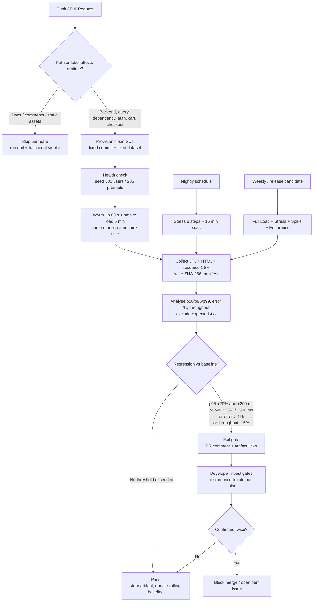

# Task 3 — Continuous Performance Testing proposal

**Student:** Phan Trung Tin — 23120372  
**Context:** EShop SUT (`https://github.com/ttbhanh/eshop-sut`) tested with JMeter 5.6.3 on a single Windows laptop.  
**Goal:** catch performance regressions in pull requests without turning every commit into a 15-minute full benchmark.

---

## 1. Flow chart



The PR gate is deliberately **short and deterministic**. Expensive Stress/Spike/Endurance runs move to nightly and release schedules, where a failure does not block every pull request.

---

## 2. When to run what

| Change type | PR gate | Nightly | Release candidate |
|---|---|---|---|
| Docs, comments, README | Skip | — | — |
| Frontend-only, no API/schema change | Functional smoke | — | Full |
| Backend API, SQL, index, dependency | 5 min smoke load | Stress | Full |
| Auth / JWT / cart / checkout | 5 min E2E smoke | Stress + soak | Full |
| Infra / runtime / DB engine | 5 min smoke load | Stress + soak | Full |
| Release candidate | 5 min smoke load | — | Load + Stress + Spike + Endurance |

Path filters in `ci/perf-gate.yml` implement the “skip docs-only” rule; a maintainer can add the `perf:full` label to force a run.

---

## 3. Regression gate

Baseline = median of the last 5–10 accepted runs on the **same runner, dataset, JMeter version and steady-state window**. Until that history exists, the first accepted run becomes `ci/baseline.json` and is reviewed manually.

| Metric | Threshold | Rationale |
|---|---|---|
| p95 latency | +20% **and** +200 ms absolute | Relative-only thresholds fail on a 10 ms baseline; absolute-only thresholds miss small but real regressions |
| p99 latency | +30% **or** +500 ms absolute | Tail latency is noisy; use OR so a large absolute jump still fails |
| Error rate | > 1% | Excludes expected negative tests (lockout plan is separate) |
| Throughput | −15% | Detect capacity loss even when latency looks acceptable |
| Consecutive failures | 2 runs, or a statistical test | Reduces false alarms from shared-runner noise |

The gate compares **successful requests only for latency** and reports error codes separately. A 401/403 from the lockout probe never enters this calculation.

---

## 4. Cost analysis

| Item | Estimate | Mitigation |
|---|---|---|
| PR smoke run | ~5 min load + ~3 min setup/teardown | Path filters; cancel superseded runs with `concurrency` |
| Nightly stress + soak | ~30–45 min | One shared runner; off-peak schedule |
| Weekly full suite | ~60–75 min | Run only on release branches or manual dispatch |
| Runner cost | 1 Linux runner per job | Cache npm and JMeter; no GPU; no second load-generator |
| Storage | JTL + HTML per run | 30-day retention for PR artifacts; 90 days for nightly; baseline JSON is tiny |
| Maintenance | ~1–2 h/month | Review baseline after dependency upgrades; version thresholds |

The dominant cost is **developer waiting time**, not CPU: a 5-minute gate on every backend PR is acceptable; a 15-minute stress run on every commit is not.

---

## 5. False alarms

| Source | Effect | Mitigation |
|---|---|---|
| Shared/noisy CI runner | Latency spikes | Fixed runner class, warm-up, median of 2–3 runs |
| Dataset drift | Different product/order counts | Seed script + verified row counts in the manifest |
| Ramp-up included in throughput | Understated RPS | Compute steady-state window; state it in the report |
| Expected 4xx | Inflated error % | Separate Lockout plan; exclude by label |
| JMeter CPU saturation | Throughput drop blamed on server | Record JMeter CPU/RSS and fail the run as “invalid” if client > 85% |
| SQLite lock / port conflict | Random 500s | Health check, fresh DB, dedicated port (3100 here) |
| Tail-latency noise | One-off p99 breach | Require 2 consecutive breaches; consider Mann–Whitney/CI |
| Small baseline | Huge relative % changes | Absolute thresholds in addition to percentages |

A false alarm costs a developer ~10 minutes and erodes trust; a missed regression costs a release. The gate therefore fails only on **clear, repeated** regressions and always links the raw JTL + HTML report so the developer can verify the number.

---

## 6. Trade-offs

| Decision | Benefit | Cost / risk | Choice in this proposal |
|---|---|---|---|
| PR smoke only | Fast feedback | Does not find saturation | Yes; stress moves to nightly |
| Full stress per PR | Strongest signal | 15+ min wait, noisy on shared runners | No |
| Relative thresholds | Adapt to hardware | Fail on tiny baselines | Combine with absolute thresholds |
| Absolute thresholds | Stable across runs | Hardware-dependent | Use only as a secondary condition |
| Single run | Cheap | No statistical confidence | Allow; require a second run before blocking |
| Median of 3 runs | Robust | 3× cost | Nightly only; PR uses 1 + retry |
| Store all JTL/HTML | Full auditability | Storage growth | 30/90-day retention, baseline JSON kept forever |
| Separate negative test plan | Clean error % | Extra file/run | Yes (Lockout plan) |

---

## 7. Prototype in this repository

- `ci/perf-gate.yml` — GitHub Actions workflow: path filters, backend start, seed, 5-minute smoke load, analysis, baseline comparison, artifact upload, PR comment.
- `ci/compare_baseline.py` — threshold gate; exits 1 on regression. It reads the `analysis/load_summary.json` produced by `scripts/analyze_jtl.py`.
- `ci/baseline.json` — accepted Load run summary (created after the official run; not fabricated).
- `scripts/run_scenario.py` — same runner used locally and in CI; writes `manifest.json` with SHA-256, commit, PIDs and DB counts.

### How to validate the gate

```powershell
# Baseline = first accepted run
Copy-Item analysis\load_summary.json ci\baseline.json

# Compare the same run against itself: must PASS
python ci\compare_baseline.py --baseline ci\baseline.json --current analysis\load_summary.json

# Simulate a regression by editing a copy of the summary (never edit the raw JTL)
python -c "import json;d=json.load(open('analysis/load_summary.json'));d['labels']['POST /api/login']['latency_ok_ms']['p95']*=2;json.dump(d,open('analysis/load_regression_demo.json','w'))"
python ci\compare_baseline.py --baseline ci\baseline.json --current analysis\load_regression_demo.json
```

The second command must exit 1 and print the p95 regression line. The demo file is clearly named and is not used as evidence.

---

## 8. Rollout plan

1. **Week 1:** run the 5-minute gate in report-only mode; collect 5 baselines.
2. **Week 2:** enable blocking for backend/auth paths; keep nightly stress report-only.
3. **Week 3:** add the statistical check and a “perf:full” label for release candidates.
4. **Monthly:** review thresholds, baseline age, flaky rate and artifact size.

---

## 9. Limitations of this proposal

- The SUT uses SQLite and an in-memory cart; results do not transfer directly to a production database or multi-instance deployment.
- The current evidence runs JMeter and the backend on the same 4C/8T laptop, so high-VU steps are limited by the client.
- The PR gate uses a 5-minute smoke load; it detects regressions, not the maximum capacity. Capacity is measured by the Stress/Endurance runs.
- CI runner hardware differs from the laptop; baselines must be rebuilt per runner class and never compared across runner types.
